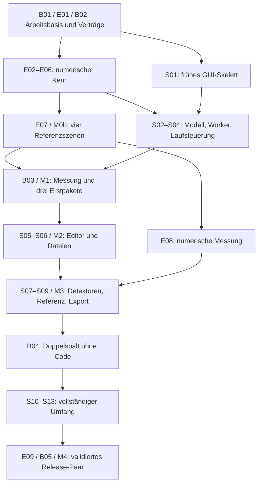

# Wave Studio – Development Plan für beide Repositories

**Zielversion:** 0.1 · **Dokumentversion:** 1.3 · **Stand:** 18. Oktober 2026

**Grundlagen:** [PRD](PRD.md), Dokumentversion 1.3, und [Projektplan](PROJECT_PLAN.md).

**Status:** Funktionsfähige lokale Mac-Entwicklungsversion **Studio 0.1.0.dev13 / Engine 0.1.0.dev4**. Der Funktionsumfang S01–S13 ist implementiert; quantitative Physikfreigabe, einzelne GUI-Reaktionszeiten, Zugänglichkeit und die abschließende Mac-Auslieferung bleiben offen. **Windows und Linux sind auf Nutzerwunsch vorerst zurückgestellt.** Ihre Anforderungen bleiben für eine spätere plattformübergreifende Freigabe erhalten und blockieren die aktuelle Mac-Arbeit nicht.

Dieser Plan beschreibt den Leistungsumfang und den aktuellen Status je Arbeitspaket. Die Arbeitsschritte umfassen auch bereits erledigte Umsetzung; die Abschlusskriterien in Abschnitten 4–9 sind Soll-Kriterien. Statuszeilen und Nachweise bestimmen den erreichten Umfang. Die priorisierte Mac-Restarbeit steht in Abschnitt 3.4, der detaillierte Fortschritt in [task.md](task.md). Historische Ergebnisse bleiben an ihren Versionsstand gebunden. Die aktuellen Prüfungen und die noch offenen Kriterien sind unten separat von den historischen Berichten ausgewiesen.

## 1. Ziel, Verbindlichkeit und Ausgangslage

Dieser Plan zerlegt den vereinbarten Umfang in Arbeitspakete für **WaveSimulator2D** und **WaveStudio**. Er legt Übergaben zwischen den Repositories, notwendige Entscheidungen und überprüfbare Abschlusskriterien fest. Die Produktanforderungen F01–F18 und Q01–Q06 aus dem PRD bleiben maßgeblich; für die aktuelle Arbeit gilt der ausdrücklich vereinbarte Mac-Schwerpunkt. Der ursprüngliche Ablauf M0–M4 dient der Zuordnung bereits umgesetzter Funktionen; die nächste Arbeit richtet sich nach Abschnitt 3.4.

Der zentrale Nutzungsablauf **Doppelspalt frei aufbauen → manuell starten → Feld und Intensität betrachten → Detektorprofil messen → Referenz festhalten → PNG/CSV exportieren → Projekt speichern und wieder öffnen** ist implementiert und im tatsächlichen Qt-/Worker-/Paketablauf geprüft. Linse, zweite Ansicht und Geometriemessung sind ebenfalls vorhanden.

### 1.1 Lokal geprüfter Stand

| Bereich | Nachgewiesener Stand am 18. Oktober 2026 | Grenze / nächste Arbeit |
| --- | --- | --- |
| Anwendung | Studio dev13: freier Editor, Laufsteuerung, Messung/Referenzen, Dateien/Exporte, Linse, zwei Ansichten, Qualitäts-/Rechenmodi und Hilfe. | Vollständige Release-Abnahme offen; [Mac-Bediennachweise](docs/MAC_ACCEPTANCE.md). |
| Engine | Engine dev4: kalibrierter Neunpunkt-Stencil, additive Quellen, Material-/Wandraster, zeitbezogene Dämpfung, passive Messung und CPU/MPS. | T01–T04 bestehen historische v1-Demonstrationsgrenzen; quantitative Abnahme offen ([Grenzwertprüfung](../WaveSimulator2D/docs/TOLERANCE_REVIEW.md)). |
| Integration / Paket | Python 3.12, getrennte Repositories, Editable-Entwicklung und feste Engine-Wheels; `dist/ax-dev13/WaveStudio.app` enthält seine Laufzeit. Dev13-Paketablauf aus `/private/tmp` bestanden; historisches dev8 unter `dist/WaveStudio.app` erhalten. | Sauberer fremder Mac, Mindestbetriebssystem und öffentliche Auslieferung offen ([Build](docs/native-dev13/build-results.json), [Paketablauf](docs/native-dev13/workflow-results.json)). |
| Letzter Teststand | 76 Kern-/Qt-/Referenztests bestanden (11,88 s); weitere unabhängige Physikreferenzen und native AX-Korrekturen implementiert. | Aktuelle Regression; native AX- und Paketnachweise separat, kein Ersatz für menschliche Abnahme. |
| Ressourcen | 512²-Budgets historisch auf CPU/MPS bestanden. Balanced-Linse auf MPS zugelassen; dev8-Paketvergleiche etwa 15–16 Frames/s. | Dev8-Gesamtnachlauf `passed=false`: GUI-Unterbrechung 500,86 ms bei Grenze 250 ms; kein 18–20-FPS-Versprechen ([Untersuchung](docs/PERFORMANCE_INVESTIGATION.md)). |

Quellstand vor dieser Dokumentaktualisierung: Studio `148619c`, Engine `053195f`. Das geprüfte dev8-Bundle ist laut Buildbericht den Code-Ständen Studio `10e1d50` / Engine `10f7ce9` zugeordnet; spätere Dokumentations-/Diagnoseänderungen sind kein neuer Bundle-Nachweis. Die Ausgangslage vom 16./17. Oktober bleibt in Git und [DEVELOPMENT_HISTORY.md](docs/DEVELOPMENT_HISTORY.md) nachvollziehbar.

### 1.1a Fortschritt der Mac-Restarbeit

- **MAC-01:** Historische Grenzen zentralisiert, T02-Winkel mit gemessenem Einfall erneut ausgewertet. Unabhängige Hankel-Quellenreferenz und Lippmann-Schwinger-Linsenreferenz mit eigenen Kalibrierungen umgesetzt. Definierter Punktfall besteht; Linie verfehlt Fenster-/Randkriterien, Linsenreferenz verfehlt noch die komplexe Rasterkonvergenz. Kein quantitativer Preset-Gesamtpass; [Methoden, Rohberichte und nächste Schritte](../WaveSimulator2D/docs/QUANTITATIVE_PROGRESS.md). Die 2-%-/0,5-%-Pilotkriterien gelten nur für die versionierten neuen Teilprotokolle; v1-Grenzen unverändert.
- **MAC-02:** dev11-Paket mit echtem 33-ms-Abfragetakt im ruhigen Lauf etwa 25–26 Frames/s, Stromsparmodus aus. Kein direkt vergleichbarer Geschwindigkeitsgewinn gegenüber dev8 mit Stromsparmodus an. Uninstrumentierter dev11-Ressourcenlauf scheitert mit 252,316 ms an unverändert 250 ms. Ereignis-/GC-Spur ergänzt, Ursache noch offen; [Untersuchung](docs/PERFORMANCE_INVESTIGATION.md#mac-02-follow-up--dev11-18-october-2026).
- **MAC-03:** Unnötiges Neuanwenden des Styles bei physikalischen Änderungen entfernt. Zusätzlicher Listenersatz in dev10–12 genügt nativ nicht und wird nach einem Qt-6.8-Vergleichsabsturz in dev13 entfernt. Dev13 bestätigt den korrigierten Eigenschafts-/Undo-/Redo-Weg nativ, aber Add verliert weiter das AX-Outline. Strukturelle/Style-Wechsel und menschliche VoiceOver-Abnahme bleiben offen; [Nachprüfung](docs/MAC_ACCESSIBILITY_FOLLOWUP.md).
- **MAC-04:** [Mac-Auslieferung](docs/MAC_DISTRIBUTION.md) vorbereitet. Statische dev8-Inventur: nur arm64, höchste deklarierte macOS-Mindestversion 26.0 in Qt-Bindings. Das ist noch keine Laufabnahme auf macOS 26. Lizenzunterlagen, Verteilungsentscheidung und sauberer Fremd-Mac bleiben offen.

### 1.2 Feste Leitplanken

- Ein geöffnetes Projekt und genau eine aktive Simulation. Auch zweite Ansicht und Referenzprofile erzeugen keinen weiteren Lauf.
- Physikalische Änderungen nur vor dem Start oder nach Pause. Danach bleibt die Anwendung angehalten; ausschließlich **manueller Run** initialisiert und startet den geänderten Versuch. Step bleibt bis dahin gesperrt.
- Darstellung und passive Detektoren dürfen während eines Laufs geändert werden. Nur der betroffene Detektor beginnt bei einer gültig übernommenen Messänderung neu.
- Geometrie bleibt in festen Projektreferenzeinheiten erhalten. Qualitätsstufe, Rechenmodus und sichtbarer Ausschnitt sind getrennte Einstellungen.
- Aktuelle Mac-Basis: CPU und auf Apple M1 geprüftes MPS. CPU auf Windows/Linux bleibt spätere Anforderung; CUDA wird ohne NVIDIA-Hardwaretest nicht angeboten und ist keine Pflicht für 0.1.
- Die Anwendung arbeitet offline und wird mit ihrer Laufzeit ausgeliefert. Releases verwenden ein fest versioniertes Engine-Paket.
- Die Oberfläche einschließlich Beispielen und Hilfen ist Englisch. Dieses Entwicklungsdokument bleibt Deutsch.
- Der Prüfungsumfang bleibt bei T01–T09 aus dem PRD: vier physikalische Referenzen, zwei Bedienabläufe und kurze Ressourcen-, Backend- und Paketprüfungen.

Es gibt keinen zugesagten Termin. Eine belastbare Aufwandsschätzung für die verbleibende Mac-Arbeit fehlt; sie wird anhand der offenen Physik-/GUI-Befunde aktualisiert (MAC-04). Bereits implementierte M2–M4-Funktionen werden nicht erneut als künftiger Ausbau geplant.

## 2. Zuständigkeiten und technische Übergaben

### 2.1 Verantwortung je Repository

| Verantwortung | WaveSimulator2D | WaveStudio |
| --- | --- | --- |
| Numerisches Modell | Fortschreibung, Stabilität, normierte Raum-/Zeitskalierung, Quellenanregung, Hindernisbedingung und Dämpfung | Verständliche Parameter, Auswahl der validierten Konfiguration und Vorabprüfung |
| Geometrie | Numerische Rasterisierung und solvergerechte Material-/Wandfelder | Kontinuierliche Objektgeometrie, Objekt-IDs, sichtbare Reihenfolge und Bearbeitung |
| Szenenübersetzung | Qt-unabhängige Funktionen zum Aufbau numerischer Daten | Kleiner Scene Compiler in `simulation/`, der Projektobjekte auf diese Engine-Funktionen abbildet |
| Lauf | Ein numerischer Zustand, explizites Rechengerät, Schritte und vollständiger numerischer Reset | Ein Worker, Zustandsmaschine, Projektwechsel, `run_id`, `scene_revision` und Fehlerdarstellung |
| Messung | Numerisches Sampling und Mittelung auf Basis der Simulationszeit, möglichst auf dem Rechengerät | Detektorkonfiguration, Messrevisionen, Status, Referenzverwaltung, Vergleich und Export |
| Darstellung | Numerische Daten und Metadaten; bestehende Beispielvisualisierung getrennt halten | PySide6/PyQtGraph, Felder, Diagramme, Overlays, Farben und Ansichten |
| Dateien | Paket-/API-Version, technische Referenzkonfigurationen und numerische Nachweise | Projektformat, Wiederherstellung, PNG/CSV, Benutzerbeispiele und Anwendungspakete |
| Freigabe | Engine-Wheel, Änderungsnotizen und passender numerischer Prüfbericht | Feste Engine-Abhängigkeit und Integrationsnachweise; aktuell Mac-Paket, Windows/Linux später |

Die Anwendung darf numerische Fehler nicht durch eigene Solver-Sonderfälle verdecken. Umgekehrt kennt die Engine weder Qt-Widgets noch das WaveStudio-Projektformat. Die fachliche Definition der Messung liegt in WaveStudio; die dafür benötigten numerischen Operationen liegen in der Engine. So bleibt die Auswertung ohne GUI prüfbar und wird nicht vom Renderer abhängig.

### 2.2 Vorhandene Struktur

```text
WaveStudioApp/                         # Arbeitsbereich, kein drittes Git-Repository
├── README.md
├── WaveStudioApp.code-workspace       # Zwei relative Repository-Pfade
├── WaveSimulator2D/                   # Repository 1: Simulations-Engine
│   ├── .git/
│   ├── pyproject.toml                 # Engine 0.1.0.dev4
│   ├── wave_sim2d/                    # Bestehendes Importpaket zunächst erhalten
│   │   ├── wave_simulation.py
│   │   ├── config.py / geometry.py / dispersion.py / measurements.py
│   │   └── scene_objects/
│   ├── tests/                        # Portable Kernprüfungen
│   ├── validation/                   # T01–T04, Toleranzen und Alt/Neu-Vergleich
│   └── docs/                         # Modell, physikalische Nachweise und Grenzwertprüfung
└── WaveStudio/                        # Repository 2: Desktop-Anwendung
    ├── .git/
    ├── README.md
    ├── PRD.md
    ├── PROJECT_PLAN.md
    ├── DEVELOPMENT_PLAN.md
    ├── task.md                       # Detaillierter Fortschritt und offene Mac-Aufgaben
    ├── pyproject.toml                 # Studio dev13, feste Abhängigkeit auf Engine dev4
    ├── src/wave_studio/
    │   ├── app.py
    │   ├── domain/                    # Projekt, Geometrie, Einheiten, Validierung
    │   ├── simulation/                # Scene Compiler, Adapter, Worker, Laufsteuerung
    │   ├── persistence/               # Projektformat, Wiederherstellung, Exporte
    │   └── ui/                        # Fenster, Editor, Eigenschaften, Ansichten, Plots
    ├── examples/                      # Drei bearbeitbare Projektdateien, auch als Paketdaten
    ├── packaging/                     # Wheel-basierter nativer Build
    ├── scripts/                       # Qualitäts-, Backend- und Ressourcenprüfungen
    ├── tests/                         # Kern-/Qt-Regressionen aus T05/T06
    └── docs/                          # Verträge, Entscheidungen, Abnahme, Builds und Rohdaten
```

Die Übersicht zeigt die wesentlichen vorhandenen Teile. Messoperationen liegen in der Engine; Messkonfiguration/Referenzen in Studio-Domäne, Worker und UI. Ein separates `analysis/`-Paket wurde dafür nicht benötigt. `WaveStudioApp/` ist der gemeinsame Arbeitsbereich; Git-Versionierung erfolgt getrennt in seinen beiden Repository-Unterordnern.

Ein umfassender Umbau der Engine-Verzeichnisstruktur ist keine Voraussetzung. Vorhandene Beispiele bleiben getrennt nutzbar; jede notwendige API-Änderung wird mit einer kurzen Umstellungsnotiz erklärt.

### 2.3 Minimaler Vertrag zwischen Engine und Anwendung

B02 ist in [CONTRACT.md](docs/CONTRACT.md), die numerische Bedeutung in [MODEL.md](../WaveSimulator2D/docs/MODEL.md) dokumentiert. Die folgenden Namen beschreiben die Aufgaben; konkrete API-Signaturen ergeben sich aus der Implementierung.

| Operation/Daten | Erforderliche Bedeutung |
| --- | --- |
| Szene vorbereiten/laden | Geprüfte Dimensionen, Achsenkonvention, Gitter, Zeitschritt, Materialfelder, Quellen, Wandmaske, Randzone, Gerät und Datentyp übernehmen. Teilweise ungültige Szenen werden nicht aktiviert. |
| `step(count)` | Genau die angeforderte Zahl numerischer Schritte berechnen; keinen eigenen unbegrenzten Hauptloop starten. Simulationszeit und Schrittzahl bleiben auslesbar. |
| Zustand lesen | Nur angeforderte Feld-/Material-/Messdaten liefern. Speicherbesitz und Lebensdauer sind ausdrücklich beschrieben; die GUI erhält keine nachträglich veränderten Tensoransichten. |
| Vollständig zurücksetzen | Zeit, aktuelle und vorherige Felder sowie numerische Messakkumulatoren zurücksetzen. WaveStudio löscht dazu aktuelle Resultate; gespeicherte Referenzen bleiben bestehen. |
| Messkonfiguration übernehmen | Änderung an einer Schrittblockgrenze bestätigen; das tatsächliche Wirksamwerden bildet den Beginn der neuen Messrevision. |
| Fehler melden | Ungültige Konfiguration von nicht fortsetzbarem Laufzeitfehler unterscheiden; konkrete Ursache transportieren. Keine verborgenen automatischen Neustarts oder Gerätewechsel. |

Ergebnis-Snapshots erhalten mindestens `scene_revision`, `run_id`, Simulationszeit und Schrittzahl. Messresultate ergänzen Detektor-ID und Messrevision. Zur langfristigen Ergebniszuordnung gehören außerdem der tatsächliche physikalische Szenenstand, Engine-Version, Gitter, Zeitschritt, Laufdauer, Backend, Datentyp, Ortskoordinaten, Einlaufphase, Messfenster, Samplezahl, Abtastung und Mittelungsverfahren. Eine Revisionsnummer allein ersetzt keinen gespeicherten Szenenstand.

### 2.4 Zustands- und Änderungsregeln

| Ereignis | Wirkung auf Lauf und Daten |
| --- | --- |
| Run aus bereit | Gültige Szene vorbereiten, neue Lauf-ID vergeben, frische Felder/Messungen starten. |
| Pause, danach Run ohne physikalische Änderung | Derselbe Lauf setzt mit unveränderter Zeitbasis und Lauf-ID fort. |
| Gültige physikalische Änderung, auch Undo/Redo | `scene_revision` erhöhen, bisherigen Lauf als überholt markieren, angehalten bleiben; Step sperren. Konservativ bleibt auch nach Zurücknehmen einer Änderung ein neuer manueller Run erforderlich. |
| Run nach physikalischer Änderung | Alte Übergabedaten verwerfen, aktuelle Szene neu übersetzen und neuen Lauf mit frischen Feldern/Messungen beginnen. |
| Step | Nur im initialisierten pausierten, zum Aufbau passenden Lauf genau einen Schritt ausführen. Reset gibt den numerischen Zustand frei und sperrt Step bis zum nächsten Run → Pause. |
| Reset | Lauf nicht automatisch fortsetzen; Felder und aktuelle Messungen löschen, Referenzen erhalten. Ausstehende Daten des alten Zustands dürfen nicht wieder erscheinen. |
| Gültige Detektoränderung | Nur Messrevision und aktuelle Messung dieses Detektors ändern; Feld, Simulationszeit, Lauf-ID, andere Detektoren und Referenzen erhalten. |
| Farbskala, Helligkeit oder Ausschnitt | Keine Änderung an Physik oder Messung. Gespeicherte Anzeigeänderungen können den Projekt-Speicherstatus ändern. |
| Ungültige Eingabe | Nicht übernehmen; gültige Konfiguration und ein gültiger laufender Versuch bleiben erhalten. |
| Nicht fortsetzbarer Simulationsfehler | Lauf stoppen, Szene erhalten, Ursache anzeigen; erst nach Behebung und Nutzeraktion neu beginnen. |
| Projektwechsel/Beenden | Worker kontrolliert anhalten, alte Datenübernahme sperren und bisherigen numerischen Zustand freigeben. Eine neue Projektdatei vor dem Austausch vollständig validieren. |

Projekt-Speicherstatus, physikalische Revision und Messrevision werden separat geführt. Reset erneuert die Generation und verwirft verspätete Daten auch ohne Szenenänderung; der Vertrag und die Regressionen decken das ab.

## 3. Reihenfolge, Abhängigkeiten und Meilensteine

**ID-Legende:** E = Engine, S = Studio, B = beide Repositories bzw. gemeinsame Integration. Jedes Arbeitspaket hat genau einen fachlichen Verantwortungsbereich; B-Pakete führen die getrennten Ergebnisse zusammen. „Parallel möglich“ bezeichnet unabhängige Entwicklungsarbeit, niemals mehrere gleichzeitige Simulationsläufe im Produkt.

### 3.1 Abhängigkeitsübersicht

Die Tabelle erhält die ursprünglichen fachlichen Abhängigkeiten. Die Mac-Implementierung ist bereits durchgängig vorhanden. Windows-/Linux-Anteile von B03/B05 bleiben zurückgestellt; quantitative E07-/S12-Freigabe und Mac-Restarbeit sind in Abschnitt 3.4 aufgeführt.

| ID | Arbeitspaket | Repository | Phase | Voraussetzungen |
| --- | --- | --- | --- | --- |
| B01 | Arbeitsbasis und Repository-Setup | Beide | M0a | Keine |
| E01 | Installierbare Engine und portable Prüfungen | Engine | M0a | B01 |
| B02 | Daten-, API- und Lebenszyklusvertrag | Beide | M0a | B01 |
| E02 | Skalierung, Stabilität und Parameterbereich | Engine | M0a | B02 |
| E03 | Einheitliches Gerät, Initialisierung und Reset | Engine | M0a | E01, E02 |
| E04 | Konsistente additive Quellen | Engine | M0a | E03 |
| E05 | Rasterisierung, Materialreihenfolge und Wände | Engine | M0a | E03 |
| E06 | Dämpfung und getrennte Randzone | Engine | M0a | E02, E05 |
| E07 | Vier physikalische Referenzen und M0-Nachweis | Engine | M0b | E04, E05, E06 |
| S01 | Anwendungsskelett und Feldansicht | Studio | M1, früh startbar | B01, E01 |
| S02 | Projektmodell und Szenenübersetzung | Studio | M1 | B02, E02; numerische Anbindung mit E04–E06 |
| S03 | Adapter, Worker und begrenzte Übergaben | Studio | M1 | S01, S02, E03–E06 |
| S04 | Laufsteuerung und Fehlerpfade | Studio | M1 | S03 |
| B03 | Prototyp, native Erstpakete und Budgets | Beide | M1 | E07, S04 |
| S05 | Freier Szeneneditor und Undo/Redo | Studio | M2 | B03, S02, S04 |
| S06 | Projektdateien und Wiederherstellung | Studio | M2 | S05, B02; O06 für Wiederherstellung geklärt |
| E08 | Numerische Messung und Zeitmittelung | Engine | M3 | E07, B02; O06 für Messfenster geklärt |
| S07 | Passive Detektoren und Messstatus | Studio | M3 | E08, S05, S04 |
| S08 | Referenzprofile und gemeinsamer Vergleich | Studio | M3 | S07, S06 |
| S09 | PNG-/CSV-Export mit Ergebniszuordnung | Studio | M3 | S08 |
| B04 | Vollständiger Doppelspalt-Ablauf | Beide | M3 | S09 |
| S10 | Parametrisches Linsenwerkzeug | Studio | M4 | B04, E07, S05; O05 geklärt |
| S11 | Zweite Ansicht, Abstands- und Winkelwerkzeuge | Studio | M4 | B04, S07 |
| S12 | Finale Qualitätsstufen, Geräte- und Rechenmodi | Studio | M4 | B03, S10, E08 |
| S13 | Beispiele, Bedienbarkeit und Produktdokumentation | Studio | M4 | S10, S11, S12, S09 |
| E09 | Engine-Stabilisierung und versioniertes Release | Engine | M4 | E08, S12 |
| B05 | Gemeinsame Release-Abnahme und Auslieferung | Beide | M4 | E09, S13, B04 |

### 3.2 Ursprüngliche Entwicklungslinien und heutige Einordnung



Die Grafik erhält den ursprünglichen Aufbaupfad. Der lokale Ausbau wurde nach den v1-Demonstrationsreferenzen und dem Mac-Prototyp fortgesetzt; Windows/Linux wurden ausdrücklich verschoben. Die spätere Grenzwertprüfung zeigt offene quantitative Nachweise. Deshalb bedeutet das Vorhandensein aller Funktionsblöcke keine abgeschlossene M4-Freigabe.

Die derzeit blockierenden Mac-Befunde betreffen quantitative Physik, einzelne GUI-Unterbrechungen und Zugänglichkeit. Technische Arbeit kann in diesen Bereichen unabhängig vorankommen; die gemeinsame Freigabe benötigt ihre passenden Abschlussnachweise und die Auslieferungsentscheidungen.

### 3.3 Abschluss der Meilensteine

| Meilenstein | Aktueller Stand | Verbleibende Einschränkung |
| --- | --- | --- |
| M0a | B01/B02/E01–E06 implementiert; Umgebung, Verträge und Kernprüfungen vorhanden. | Quantitative Reichweite wird unter E07/S12 weiter geprüft. |
| M0b | T01–T04 ausführbar und gegen eingefrorene v1-Demonstrationsgrenzen bestanden. | Begründete quantitative Fehlerbilanz/Referenzen offen (MAC-01). |
| M1 | Mac-Prototyp, Paket, CPU/MPS und lokale 512²-Budgets nachgewiesen. | Dev8-/dev11-GUI-Nachlauf fehlgeschlagen (MAC-02); Windows/Linux und schwächere Hardware zurückgestellt. |
| M2 | Freier Editor, Undo/Redo, sichere Dateien und Wiederherstellung implementiert/geprüft. | Native AX-/Command-Z-Korrekturen in Arbeit; vollständige Bedien-/VoiceOver-Abnahme offen (MAC-03). |
| M3 | Detektoren, Referenzen, PNG/CSV und vollständiger Doppelspalt-Paketablauf nachgewiesen. | Finale Zuordnung zum späteren Release-Stand unter MAC-05. |
| M4 | S10–S13-Funktionen vorhanden; lokale Mac-Entwicklungsversion verfügbar. | S12/S13-Freigabe und E09/B05 offen; MAC-01–06. Plattformübergreifender Abschluss zurückgestellt. |

Ein nicht bestandener physikalischer Nachweis wird nicht durch eine optisch plausible GUI ersetzt. Windows/Linux bleiben als spätere Anforderungen sichtbar; die ausdrückliche Verschiebung erlaubt die separate Arbeit an einer Mac-Freigabe.

### 3.4 Priorisierte offene Aufgaben für die Mac-Version

P1 = zuerst für belastbare Ergebnisse und Bedienbarkeit, P2 = Abschlussvorbereitung, P3 = finale Freigabe/Auslieferung nach den erforderlichen Vorarbeiten. Die IDs MAC-01–06 werden auch in [task.md](task.md) verwendet. Sie ordnen bestehende Arbeit, ohne zusätzliche Produktfunktionen oder einen Veröffentlichungstermin zu versprechen.

| Priorität / ID | Aufgabe und Zuordnung | Konkretes Abschlusskriterium / Abhängigkeit |
| --- | --- | --- |
| **P1 · MAC-01** | **Quantitative Physik und Qualitätsstufen absichern** — E07/S10/S12, O02/O04, T01–T04/Q04. Neue versionierte Grenzwerte aus einer Fehlerbilanz begründen; passende unabhängige Quellen-/Spalt-/Linsenreferenzen, dritte gezielte Rasterstufe für unklare Spalt-/Linsenfälle, getrennte Zeit-/Rand-/Fenster-/Geometrie- und Auswertungsunsicherheit prüfen. T02 mit tatsächlich gemessenem Einfallswinkel auswerten; Grenzen zentralisieren und Phasenanforderung aus der Messaufgabe ableiten. Balanced-/High-Quality-Fokus gesondert prüfen. | Referenzen, Unsicherheiten, zulässige Parameter und tatsächlich geprüfte Presets sind vor Freigabe nachvollziehbar dokumentiert. Vorschläge von 2 % bzw. ≤1 % Fokusunsicherheit sind noch keine allgemeinen Produktanforderungen oder bestandenen Preset-Ziele. Begrenzte neue Quellen-/Linsen-Teilprotokolle verwenden diese explizit als Pilotkriterien; [Fortschritt](../WaveSimulator2D/docs/QUANTITATIVE_PROGRESS.md). Ressourcenablehnung/ungetestete Raster bleiben so gekennzeichnet; v1-Berichte unverändert erhalten. Ausgangspunkt: [Grenzwertprüfung](../WaveSimulator2D/docs/TOLERANCE_REVIEW.md), [Fehlermaße](../WaveSimulator2D/docs/ERROR_METRICS.md). |
| **P1 · MAC-02** | **GUI-Unterbrechungen eingrenzen und beheben** — S03/S12/B03, T05/T07/Q02–Q03. Dev8-Befund 500,86 ms bei 250-ms-Grenze untersuchen; produktiven Qt-Abfragetakt und vergleichbare Start-/Aktivitäts-/Stromsparzustände erfassen. | Gezielter Nachweis für die Korrektur und betroffene Ressourcen-/Bedienprüfung am passenden Paket; unveränderte Budgets, Fehlerberichte erhalten. 512² und große Balanced-Linse getrennt bewerten; kein pauschales 18–20-FPS-Ziel. Die gesamte historische FPS-Differenz bleibt ungeklärt, soweit sie nicht reproduzierbar belegt wird. Ausgangspunkt: [Performance-Untersuchung](docs/PERFORMANCE_INVESTIGATION.md). |
| **P2 · MAC-03** | **Zugänglichkeit und native Tastaturbedienung abschließen** — S05/S13, T05/T06/F16. Verbleibenden AX-Verlust nach strukturellen/Style-Wechseln untersuchen, VoiceOver-/Fokusverhalten und native Command-Z-/Redo-Wege prüfen; verbleibende menschliche Bedienabnahme am finalen Kandidaten dokumentieren. | Nachweisbare Bedienbarkeit im vereinbarten Umfang, einschließlich Themes und skalierter Schrift; Qt-, agentenbediente native und menschliche Prüfungen getrennt ausweisen. Sichtbare Liste/Qt-Fokus allein gelten nicht als AX-Abnahme. Ausgangspunkt: [Mac-Abnahme](docs/MAC_ACCEPTANCE.md). |
| **P2 · MAC-04** | **Mac-Auslieferungsumfang und Restaufwand festlegen** — B03/B05, O03/O07. Mindest-macOS/Architektur und verfügbare fremde Mac-Testinstallation bestimmen; Verteilung, erforderliche Signierung/Notarisierung und Aktualisierungsweg klären. Abhängigkeiten/Lizenzhinweise prüfen und Restaufwand samt Voraussetzungen schätzen. | Dokumentierte Mac-Matrix, Auslieferungsentscheidungen und Aufwandsspannen. Aktuell nur M1/8 GiB, macOS 27.0.1 arm64 geprüft. Manueller Paketaustausch ist zulässig; automatischer Updater keine Pflicht. Kann unabhängig vorbereitet werden, belastbare Schätzung nach Eingrenzung von MAC-01/02. |
| **P3 · MAC-05** | **Finales Versionspaar und gemeinsame Mac-Abnahme erstellen** — E09/B04/B05/S13. Finale Engine und Studio eindeutig versionieren, exakte Wheels/Hashes und Commits zuordnen; betroffene T01–T08 auf diesem Stand prüfen und F01–F18/Q01–Q06 mit Nachweisen, Grenzen oder zurückgestellten Plattformteilen verknüpfen. Hilfe, Preset-Aussagen, Änderungs-/Release-Notizen und Installationshinweise abgleichen. | Nach MAC-01–04: vollständige Mac-Abnahmeübersicht ohne offene Abweichung gegen den beanspruchten Umfang; keine neue Freigabe aus alten dev3/dev4-Berichten ableiten. Keine pauschale Wiederholung aller Prüfungen für unveränderte Bereiche. |
| **P3 · MAC-06** | **Mac-Paket auf sauberer Installation abnehmen und zur Verteilung vorbereiten** — B05/T09/Q01. Aus dem finalen Versionspaar bauen, gegebenenfalls für öffentliche Verteilung signieren/notarisieren, auf fremdem sauberem Mac ohne Nutzer-Python und ohne Netzwerk Kernablauf prüfen. | Nach MAC-04/05: tatsächlich ausgeliefertes Artefakt mit Hash, OS/Hardware, Start/Run/Pause, Speichern/Laden, PNG/CSV und Installationshinweisen dokumentiert. Öffentliche Veröffentlichung erst nach geklärtem Verteilungsumfang. |

**Zurückgestellt:** Windows-/Linux-Builds, native Offline-Abnahmen, dortige CPU-/schwächere Hardware und Plattformmatrix. CUDA bleibt ohne NVIDIA-Nachweis außerhalb der Unterstützung. Diese Punkte sind keine Voraussetzung für die aktuelle Mac-Restarbeit.

**Ergänzende Untersuchung:** Der vollständige Vergleich zur alten Engine für Quellen, Dämpfung, Spalt und Linse bleibt offen. Der vorhandene kalibrierte quellenfreie Vergleich belegt keine allgemeine Genauigkeit. Ein umfassender Alt/Neu-Vergleich ist keine eigenständige PRD-Pflicht und ersetzt MAC-01 nicht. Kalibrierte Energie-/Prozessmessung ist ebenfalls offen; vorhandene systemweite GPU-Zähler sind entsprechend begrenzt, zusätzliche privilegierte Messungen sind nicht eingeplant.

## 4. M0a – Arbeitsbasis und numerischer Kern

### B01 – Arbeitsbasis und Repository-Setup

**Aktueller Status (18.10.2026):** **Abgeschlossen für die lokale Entwicklungsbasis.** Python 3.12, zwei Repositories, Editable-Installation und Build-Anleitung vorhanden; [Entwicklungsanleitung](docs/DEVELOPMENT.md).

**Verantwortung:** Beide Repositories. **Voraussetzungen:** Keine. **Bezug:** Technische Rahmenbedingungen im PRD.

**Arbeitsschritte:**

- Bereits erledigt: Engine einschließlich Git-Verlauf und lokalen Änderungen nach `WaveStudioApp/WaveSimulator2D/` verschieben; `WaveStudioApp/WaveStudio/` als eigenes Git-Repository initialisieren und die Planungsdokumente dorthin übernehmen.
- Die vorhandene `WaveStudioApp.code-workspace` öffnet beide Repositories über relative Pfade. Python 3.12 und die Editable-Entwicklungsumgebung sind in README und Entwicklungsanleitung dokumentiert.
- Ignorierregeln für Umgebungen, Python-Caches, Build-Ausgaben und lokale Messartefakte anlegen. Bereinigung bereits versionierter Caches als eigene nachvollziehbare Änderung behandeln.
- Kurze Entwicklungsanleitung und Orte für Entscheidungen, Prüfberichte und die Zuordnung beider Repository-Stände festlegen.

**Lieferobjekte:** Repository-Grundstruktur, Entwicklungsanleitung, Baseline mit Engine-Commit und offenem Arbeitsstand.

**Abschlusskriterien:**

- Beide Repositories lassen sich unabhängig versionieren; bestehende fremde Änderungen bleiben nachvollziehbar.
- Ein neuer Entwickler findet Umgebung, Startpunkte und die Reihenfolge E01 → editierbare Integration ohne versteckte lokale Importpfade.
- Anforderungen und geplanter Umfang sind den beiden Repositories eindeutig zugeordnet.

### E01 – Installierbare Engine und portable Prüfungen

**Aktueller Status (18.10.2026):** **Abgeschlossen für die lokale Paketintegration.** Engine-Wheel und isolierter CPU-/Detektorpfad geprüft; feste Engine-Abhängigkeit im Mac-Bundle. Finale Freigabe unter E09/MAC-05.

**Verantwortung:** WaveSimulator2D. **Voraussetzungen:** B01.

**Arbeitsschritte:**

- `pyproject.toml`, auslesbare Paketversion und Wheel-Build ergänzen; das Importpaket `wave_sim2d` zunächst beibehalten.
- Kernabhängigkeiten von Beispielvisualisierung trennen. Falls OpenCV für Rasterisierung bleibt, die mit Qt verträgliche Headless-Variante im Anwendungspfad vorsehen; widersprüchliche OpenCV-Pakete vermeiden.
- Die bereits auf den Skriptordner umgestellte Importauflösung in `test_comprehensive.py` bei der Paketierung berücksichtigen und weitere Bestandsprüfungen portabel machen. Numerische Prüfungen dürfen kein Visualisierungsfenster voraussetzen und müssen bei Fehlern einen fehlschlagenden Prozess liefern.
- Installation als editierbare lokale Abhängigkeit in der Studio-Umgebung sowie Installation aus einem gebauten Wheel prüfen. Konkreten Distributionsnamen und Versionskonvention dokumentieren.

**Lieferobjekte:** Installierbares Engine-Paket, reduzierter Abhängigkeitssatz, dokumentierter Build-/Prüfbefehl.

**Abschlusskriterien:**

- Import und ein kleiner CPU-Lauf funktionieren aus einer sauberen Umgebung außerhalb des Quellordners.
- Änderungen im Engine-Quellcode werden bei editierbarer Installation in Studio sichtbar; für den Wheel-Test ist der Nachbarquellordner nicht nötig.
- Das Kernpaket importiert keine optionalen GUI-Beispielmodule beim normalen Solver-Import.

### B02 – Daten-, API- und Lebenszyklusvertrag

**Aktueller Status (18.10.2026):** **Abgeschlossen.** [CONTRACT.md](docs/CONTRACT.md) und [MODEL.md](../WaveSimulator2D/docs/MODEL.md) definieren Einheiten, Puffer und Lebenszyklus; Reset erneuert die Generation und sperrt Step bis Run → Pause.

**Verantwortung:** Engine-API in WaveSimulator2D, Projekt-/Laufvertrag in WaveStudio. **Voraussetzungen:** B01. **Bezug:** F07–F15, Q05–Q06.

**Arbeitsschritte:**

- Die Verträge aus Abschnitt 2.3/2.4 konkretisieren: Koordinaten und Achsen, Einheiten, Datentypen, Eigentum an Puffern, Fehlerarten, Blockgrenzen und Abbruch.
- Physikalische Szene, passive Messkonfiguration und Darstellung als getrennte Datenbereiche definieren; stabile Objekt-IDs, Projekt-Speicherstatus, `scene_revision`, `run_id` und Messrevisionen festlegen.
- Reset-Identität, Step nach Initialisierung/Reset, Lebensdauer pausierter Daten und Verwerfen verspäteter Ergebnisse eindeutig entscheiden.
- Versioniertes Projektformat und Ergebnisdatensatz skizzieren, einschließlich eingefrorener Referenzwerte und deren Ursprungsszene. Numerische Feldzustände gehören nicht in die Projektdatei.

**Lieferobjekte:** Kurzer versionierter Schnittstellenvertrag, Zustandsübergangstabelle und Datenbeispiele für Szene, Frame und Profil.

**Abschlusskriterien:**

- Für jeden zentralen Bedienvorgang ist festgelegt, welche Identitäten, Daten und Zustände sich ändern.
- Ein altes Frame oder Profil lässt sich anhand des Vertrags eindeutig verwerfen; Reset ist ausdrücklich abgedeckt.
- Engine und Anwendung benötigen keine wechselseitigen internen Importe. Numerische Details aus E02–E06 sind im Modellvertrag beschrieben; offene Genauigkeitsnachweise bleiben kenntlich.

### E02 – Skalierung, Stabilität und zulässiger Parameterbereich

**Aktueller Status (18.10.2026):** **Implementiert und in den dokumentierten Referenzfällen geprüft.** c0=1, Stabilitäts-/Eingabeprüfung und Dispersionsabschätzung vorhanden. Quantitative Reichweite/Phasenanforderung unter MAC-01 offen.

**Verantwortung:** WaveSimulator2D. **Voraussetzungen:** B02. **Bezug:** F03, F06, Q04; O01/O02.

**Arbeitsschritte:**

- Die tatsächlich implementierte Fortschreibung und den 3×3-Kern analysieren. Raum-/Zeitskala, Referenzmedium, Gitterabstand, Zeitschritt, Kreisfrequenz und Wellenlänge zusammenhängend definieren.
- Den im Projektplan beschriebenen Langwellenfaktor des Kernels berücksichtigen; den bisherigen Kommentar „1 Pixel pro Zeitschritt“ nicht als Kalibrierung verwenden.
- Stabilitätsgrenzen und relevante numerische Dispersion für dieses Schema bestimmen. Zulässige Parameter und die Unterscheidung zwischen ungültiger Konfiguration und Genauigkeitswarnung festlegen.
- Kriterien für kleinste Materialwellenlänge, feinste relevante Struktur und Ausbreitungsweg vorbereiten. Noch keine Qualitätsstufe pauschal auf eine feste Zellzahl festlegen.
- Metriken und begründete vorläufige Toleranzen für T01 festhalten; die Abnahmegrenzen vor der eigentlichen Abnahme einfrieren.

**Lieferobjekte:** Modell-/Einheitendokument, zentrale Umrechnungen und Parameterprüfung, T01-Auswertungsvorgabe.

**Abschlusskriterien:**

- Eine Quellenwellenlänge hat eine eindeutige numerische Bedeutung; Änderungen skalieren die Geometrie nicht mit.
- Unzulässige Zeitschritte und ungültige Werte werden vor dem Lauf erkannt, nicht still auf andere Werte begrenzt.
- Voraussetzungen und Grenzen der Genauigkeitsaussagen sind dokumentiert; die Laufzeitbestätigung folgt in E07.

### E03 – Einheitliches Gerät, Initialisierung und vollständiger Reset

**Aktueller Status (18.10.2026):** **Implementiert und lokal auf CPU/MPS geprüft.** Einheitliches Gerät, vollständiger Reset, Initialfeldprüfung und Schritt-API; [Backendnachweis](docs/backend-results.json). Weitere Plattformen zurückgestellt, CUDA nicht angeboten.

**Verantwortung:** WaveSimulator2D. **Voraussetzungen:** E01, E02. **Bezug:** F07, F17, Q05–Q06.

**Arbeitsschritte:**

- Rechengerät und Datentyp zentral auswählen und explizit an alle Quellen, Materialobjekte, Rasterdaten und Messpuffer weitergeben. CPU muss erzwingbar sein.
- Initialfeld-Verarbeitung korrigieren: zweidimensionale Form, Achsen, zulässige Werte und konsistente Übernahme in die Zeitstufen prüfen.
- Vollständigen Reset als öffentliche Operation ergänzen. `reset_time()` allein genügt nicht; aktuelle/vorherige Felder, Zeit, laufbezogene Puffer und spätere Messakkumulatoren einbeziehen.
- Kleine kontrollierte Schrittoperationen und unterscheidbare Fehler für Konfiguration, Backend und ungültige Feldwerte bereitstellen.

**Lieferobjekte:** Einheitlicher Gerätepfad, korrigierte Initialisierung, vollständige Reset-/Schritt-API.

**Abschlusskriterien:**

- Alle beteiligten Tensoren liegen auf dem angeforderten Gerät; kein Objekt wählt eigenständig ein anderes Backend.
- Ein Lauf nach Reset entspricht innerhalb der festgelegten Toleranz einem frischen Lauf derselben Konfiguration.
- Ein falsches Initialfeld wird verständlich zurückgewiesen; Step berechnet reproduzierbar genau einen Schritt.
- CPU-Prüfung funktioniert; MPS und gegebenenfalls CUDA werden in T08 mit echter Hardware bestätigt.

### E04 – Konsistente additive Punkt- und Linienquellen

**Aktueller Status (18.10.2026):** **Implementiert; Quellen-/Überlagerungs-/Rückwellenprüfungen vorhanden.** Unabhängige Hankel-Referenz und Teilprotokolle ergänzt: definierter Punktfall besteht, Linie verfehlt Fenster-/Randkriterien. Allgemeine Quellenfreigabe und Fehlerbilanz bleiben MAC-01; [Fortschritt](../WaveSimulator2D/docs/QUANTITATIVE_PROGRESS.md).

**Verantwortung:** WaveSimulator2D. **Voraussetzungen:** E03. **Bezug:** F03, Q04; O01.

**Arbeitsschritte:**

- Additive Einspeisung einschließlich Zeitpunkt innerhalb des Schritts, Amplitudenbedeutung und Skalierung mit Gitter/Zeitschritt herleiten und umsetzen.
- Punkt- und Liniengeometrie vorberechnen; Regeln für überlappende Quellen und mehrfach getroffene Rasterzellen definieren.
- Frequenzkonvention explizit machen. Wellenlänge, Phase und Amplitude müssen über den Vertrag aus E02 steuerbar sein.
- Ungültige Quellpositionen erkennen; Quellen in Wänden zusammen mit E05 abweisen. Quellenenden und beidseitige Abstrahlung einer Linie in der Referenzkonfiguration berücksichtigen.

**Lieferobjekte:** Validierbare Quellenanregung und T01-Varianten für Phasenvergleich, Überlagerung und Rückwelle.

**Abschlusskriterien:**

- Quellen schreiben ankommende Felder nicht unbeabsichtigt als harte Randbedingung um.
- Zwei kohärente Quellen zeigen die erwartete Phasenabhängigkeit und definierte additive Überlagerung.
- Ein Auflösungs-/Zeitschrittwechsel erhält die vereinbarte Quellenbedeutung; bloßes Ersetzen von Zuweisung durch Addition gilt nicht als Nachweis.

### E05 – Rasterisierung, Materialreihenfolge und Wände

**Aktueller Status (18.10.2026):** **Implementiert und in den dokumentierten Fällen geprüft.** Halb-offenes Zellmittelpunktraster, Materialreihenfolge, frische Geometrie und Dirichlet-Wände. Beliebige Materialgrenzen erhalten keinen pauschalen Genauigkeitsnachweis; MAC-01.

**Verantwortung:** WaveSimulator2D. **Voraussetzungen:** E03. **Bezug:** F02, F04–F06, Q04–Q05.

**Arbeitsschritte:**

- Solvergerechte Rasterisierung für Rechtecke und Polygone festlegen. Die bisherige Float-Maske mit `cv2.LINE_AA` überprüfen und durch ein begründetes Verfahren ersetzen; sichtbare Kantenglättung ist kein numerischer Genauigkeitsnachweis.
- Materialüberlappung implementieren: Das oberste Material bestimmt Index und Dämpfung gemeinsam. Keine Dämpfung im oberen Material bedeutet dort ungedämpft; die Randzone kommt getrennt hinzu.
- Numerische Mittelung an Materialgrenzen begründen. Die Wahl zwischen n, c oder c² wird aus dem Modell abgeleitet.
- Rechteckige Wände mit Dirichlet-Bedingung umsetzen; die notwendigen Zeitstufen so behandeln, dass kein alter Zustand durch das Hindernis weiterwirkt.
- Cache-Regeln für Geometrie, Gitter, Material und Gerät festlegen. Für geänderte Szenen vorzugsweise neue vorbereitete numerische Objekte erzeugen; keine nur nach Feldgröße gültigen Polygonmasken weiterverwenden.

**Lieferobjekte:** Raster-/Materialaufbau, Wandmaske, Invalidierungsregel und numerische Geometrieprüfungen innerhalb T02–T05.

**Abschlusskriterien:**

- Verschobene bzw. überlappende Objekte erzeugen die beabsichtigten Index- und Dämpfungsfelder.
- Wände gelten unabhängig von darunterliegenden Materialien; Quellen in Wänden werden abgewiesen.
- Der Doppelspalt wird aus drei Wandstücken gebildet. Der Nachweis gegen Durchtritt und Umwege an Wandenden wird in T03 geführt.

### E06 – Auflösungsunabhängige Dämpfungsdefinition und Randzone

**Aktueller Status (18.10.2026):** **Implementiert; v1-Dämpfungs-/Randreferenzen bestanden.** Zeitbezogene Materialdämpfung und getrennte Randzone; quantitative Fehlerbilanz im freizugebenden Bereich unter MAC-01.

**Verantwortung:** WaveSimulator2D. **Voraussetzungen:** E02, E05. **Bezug:** F04, F06, Q04.

**Arbeitsschritte:**

- Die Dämpfungsdefinition in normierter Simulationszeit festlegen und in die benötigten numerischen Schrittparameter übersetzen. Den alten Faktor pro Schritt nicht unverändert für andere Zeitschritte übernehmen.
- Räumliche Breite und Profil der äußeren Dämpfungszone in Projektkoordinaten definieren; nutzbaren Innenbereich vom Gesamtgitter trennen.
- Frei platzierbare Absorber als Materialobjekte mit Dämpfung unterstützen. Die Kombination mit der äußeren Zone und Randwerten ausdrücklich dokumentieren.
- Für T02 einen gezielten Restreflexionsvergleich und zwei Auflösungen mit gleicher beabsichtigter Dämpfung vorbereiten.

**Lieferobjekte:** Dämpfungsumrechnung, Randzonenaufbau und T02-Messvorgabe.

**Abschlusskriterien:**

- Qualitätswechsel erhalten beabsichtigte Dämpfung und räumliche Breite innerhalb der begründeten Toleranz.
- Randzone und Materialdämpfung lassen sich getrennt konfigurieren; kein unbeabsichtigtes Überschreiben durch die Objektreihenfolge.
- Restreflexion ist messbar dokumentiert. Oberfläche und Dokumentation bezeichnen das Verfahren als gedämpfte Randzone, ohne unbelegte PML-Zusage.

## 5. M0b – Physikalische Grundlage

### E07 – Vier ausführbare Referenzszenen und numerische Abnahme

**Aktueller Status (18.10.2026):** **Referenzläufe implementiert; quantitative Freigabe offen (MAC-01).** Historische T01–T04-PASS-Werte gelten für v1-Demonstrationsgrenzen. [Grenzwertprüfung](../WaveSimulator2D/docs/TOLERANCE_REVIEW.md) dokumentiert unzureichend begründete Spalt-/Linsentoleranzen und offene Referenz-/Konvergenzunsicherheit.

**Verantwortung:** WaveSimulator2D. **Voraussetzungen:** E04–E06. **Bezug:** T01–T04, Q04; O02 und frühe Grundlage für O05.

**Arbeitsschritte:**

- Kleine, ohne GUI ausführbare Konfigurationen für freie Ausbreitung/zwei Quellen, Materialgrenze/Dämpfung, Doppelspalt und eine feste symmetrisch bikonvexe Linse erstellen.
- Pro Szene Beleuchtung, Geometrie, Material, Gitter, Zeitschritt, Laufzeit, Messbereich, Referenzannahmen, Messgröße und Toleranz festhalten. Quellenenden und Messentfernung explizit berücksichtigen.
- Für relevante Gitterempfindlichkeit zunächst zwei Auflösungen vergleichen; eine dritte nur bei ungeklärter Abweichung. Referenzwerte müssen zu Modell und Beleuchtung passen.
- Für T04 eine eindeutig definierte feste Kontur samt Dickenannahme verwenden. Das spätere parametrisierte Werkzeug darf keine abweichende Geometriebedeutung erhalten.
- Kleine numerische Auswertungshilfen erstellen und später in E08 wiederverwenden; hierfür sind noch keine Detektor-GUI oder Projektdateien erforderlich.

**Lieferobjekte:** T01–T04-Konfigurationen, reproduzierbarer Prüfaufruf, numerischer Bericht mit Rohmesswerten und Grenzen.

**Abschlusskriterien:**

- T01: Geschwindigkeit und Wellenlänge achsparallel/diagonal, Phasenabhängigkeit, Überlagerung und Rückwellenfall bestehen.
- T02: Brechungswinkel, Restreflexion und Dämpfungsvergleich bestehen für die dokumentierten Bedingungen.
- T03: Kein relevanter Durchtritt durch Wandbereiche; Symmetrie und charakteristische Minima passen zur begründeten Referenz.
- T04: Fokussierung und Fokuslage passen zur Referenz; Rasterverfeinerung verändert das Resultat nicht über die festgelegte Toleranz hinaus.
- Toleranzen wurden vor der Abnahme festgelegt. Abweichungen sind untersucht, nicht durch nachträgliches Aufweiten verdeckt.

Bei ungeklärten Abweichungen werden Skalierung, Rasterisierung, Beleuchtung, Quellenenden und Auswertung untersucht. Der Editor ist bereits implementiert; die quantitative Freigabe bleibt bis zum Nachweis unter MAC-01 offen. Eine neue Quellart oder ein anderes physikalisches Modell wäre eine gesonderte Umfangsentscheidung.

## 6. M1 – Durchgängiger Prototyp und frühe Auslieferbarkeit

### S01 – Anwendungsskelett und Feldansicht

**Aktueller Status (18.10.2026):** **Implementiert und im Mac-Paket geprüft.** Englische Qt-Oberfläche, Feld-/Material-/Intensitätsansicht und Paketstart vorhanden; [nativer Ablauf](docs/native-results.json). Fremder sauberer Mac unter MAC-06 offen.

**Verantwortung:** WaveStudio. **Voraussetzungen:** B01, E01. **Bezug:** F09, F16, Q01–Q02.

**Arbeitsschritte:**

- Eigenes Python-Paket mit Einstiegspunkt, PySide6-Fenster und PyQtGraph-Bildansicht einrichten. Qt Widgets als ersten Entwurf verwenden.
- Bereiche für Szene, Eigenschaften, Hauptansicht, Messdiagramm und Status vorsehen; zunächst nur die für den Punktquellenprototyp nötigen Elemente aktivieren.
- Englische Texte zentral verwalten; Darstellung und Geometriekoordinaten entkoppeln. Feldorientierung, Skala, Zoom und Verschieben mit einem einfachen bekannten Muster prüfen.
- Anzeige zunächst mit einem statischen Snapshot anbinden, danach mit S03 verbinden. Einen kleinen nativen Paketierungsversuch so früh wie möglich ermöglichen.

**Lieferobjekte:** Startbare Anwendung, eine Feldansicht und vorbereiteter Build-Einstieg.

**Abschlusskriterien:**

- Die Anwendung startet aus ihrem Paket und lässt sich kontrolliert schließen.
- Ein bekanntes Feld erscheint mit korrekter Achsenorientierung und numerischer Farbskala.
- Zoom und Fenstergröße ändern weder Projektgeometrie noch Simulationsgitter.

### S02 – Projektmodell, Validierung und Szenenübersetzung

**Aktueller Status (18.10.2026):** **Implementiert und geprüft.** Qt-unabhängiges Projektmodell, Validierung und Scene Compiler; Referenzgeometrie, Materialreihenfolge und Änderungen werden konsistent übersetzt.

**Verantwortung:** WaveStudio. **Voraussetzungen:** B02, E02; numerische Anbindung nach E04–E06. **Bezug:** F01–F06, Q05–Q06.

**Arbeitsschritte:**

- Qt-/Tensor-unabhängige Modelle für Projekt, feste Referenzlänge, Simulationsbereich, Qualitätskonfiguration und stabile Objekt-IDs erstellen.
- Quellen, Materialrechtecke, Polygone und Wände abbilden. Datenverträge für Linse, Detektoren, Darstellung und Referenzen bereits berücksichtigen; deren Bedienung folgt später.
- Physikalische, messbezogene und darstellungsbezogene Änderungen unterscheiden. Grenzen, endliche Zahlen, Geometriegültigkeit, Quellen/Wände und nutzbaren Innenbereich vor Übernahme prüfen.
- Einen kleinen Scene Compiler erstellen, der geordnete Projektobjekte in die Engine-Eingaben übersetzt. Numerische Rasteralgorithmen aus E05 verwenden.
- Mindestens eine feste Punktquellenszene bereitstellen; nach physikalischen Änderungen numerische Daten neu vorbereiten.

**Lieferobjekte:** Domänenmodell, Validierung und Scene Compiler mit eindeutigem Änderungsverhalten.

**Abschlusskriterien:**

- Projektmodelle sind ohne Qt-Anwendung und ohne GPU-Zustand verarbeitbar.
- Geometrie bleibt bei Quellenwellenlängenänderung gleich; Materialreihenfolge und Wandvorrang entsprechen F04.
- Ungültige Änderungen lassen die bisher gültige Konfiguration bestehen.
- Die übersetzte Punktquellenszene reproduziert den entsprechenden Engine-Aufbau; vertauschte Achsen und veraltete Raster sind ausgeschlossen.

### S03 – Engine-Adapter, Worker und begrenzte Datenübergabe

**Aktueller Status (18.10.2026):** **Implementiert; finale Reaktionszeitabnahme offen (MAC-02).** Ein Worker und Latest-only-Übergabe, begrenzte Befehls-/Schrittblöcke, Live-Anzeigesampling großer Felder und volles Pause-/Step-Raster. Dev8-/dev11-GUI-Nachläufe verfehlen 250-ms-Kriterium; Ereignis-/GC-Diagnose ergänzt.

**Verantwortung:** WaveStudio. **Voraussetzungen:** S01/S02, E03–E06. **Bezug:** F07, F09, Q02–Q03, Q05.

**Arbeitsschritte:**

- Einen dünnen Adapter für den Vertrag aus B02 implementieren. Nur der Worker besitzt und verändert die aktive Engine-Instanz.
- Den Worker zunächst in einem separaten Qt-Thread betreiben. Befehle zwischen begrenzten Schrittblöcken verarbeiten; den Thread nicht durch einen endlosen Slot für Steuerbefehle unerreichbar machen.
- Unveränderliche, gekennzeichnete Ergebnis-Snapshots übergeben; höchstens den neuesten noch nicht dargestellten Frame vorhalten. Messungen dürfen nicht durch verworfene Anzeigeframes ausfallen.
- GPU-zu-CPU-Übertragung auf benötigte Ansichten und Bildrate begrenzen. Statische Daten wiederverwenden; keine GUI-Zugriffe aus dem Worker.
- Worker-Anhalten, Projektwechsel und Schließen mit kontrollierter Freigabe implementieren; nach Freigabe keine verspäteten Daten akzeptieren.

**Lieferobjekte:** Laufender Punktquellenprototyp mit Adapter, Worker, Befehlsverarbeitung und begrenztem Frame-Puffer.

**Abschlusskriterien:**

- Genau eine Engine-Instanz berechnet den aktiven Versuch; die GUI reagiert währenddessen auf Bedienung.
- Pause und Abbruch können spätestens an der nächsten begrenzten Blockgrenze verarbeitet werden; die tatsächliche Latenz wird in B03 gemessen.
- Langsame Darstellung erzeugt keine anwachsende Frame-Warteschlange und keine veränderlichen GUI-Snapshots.
- Beim Schließen oder Projektwechsel bleiben kein laufender Worker und keine weiterhin verwendeten alten Ergebnisdaten zurück.

### S04 – Laufsteuerung, Revisionen und Fehlerbehandlung

**Aktueller Status (18.10.2026):** **Implementiert und im Kern-/Qt-/Paketablauf geprüft.** Run/Pause/Resume/Step/Reset, Generationen, Fehler ohne Autostart und Verwerfen alter Ergebnisse. Reaktionszeiten siehe MAC-02.

**Verantwortung:** WaveStudio. **Voraussetzungen:** S03. **Bezug:** F07–F08, F17, Q05–Q06; erster Teil von T05.

**Arbeitsschritte:**

- Zustände bereit, laufend, pausiert, physikalischer Aufbau geändert und Fehler gemäß B02 implementieren. Buttons, Eigenschaften und Status daraus ableiten.
- Manuellen Run, Pause, Fortsetzen, Step und vollständigen Reset integrieren. Nach physikalischer Änderung zuerst auf manuelle Run-Aktion warten.
- Überholte Felder entfernen oder eindeutig als überholt kennzeichnen; sie dürfen nicht als aktuelles Ergebnis erscheinen. Eingehende Frames und Resultate anhand ihrer Identität prüfen.
- Ungültige Eingaben von Laufzeitfehlern unterscheiden. Speichermangel, Backend-Ausfall und numerisch ungültige Felder stoppen den Lauf mit erhaltener Szene.
- Gerätewechsel kontrolliert ausführen: bisherigen Lauf anhalten und als nicht fortsetzbar behandeln, neuen Backend-Zustand erst auf Nutzeraktion berechnen.

**Lieferobjekte:** Zustandsmaschine, konsistente Steuerelemente und kurze T05-Prüfanleitung.

**Abschlusskriterien:**

- Pause → Run ohne Änderung setzt denselben Lauf fort; Step startet keinen Dauerlauf.
- Eine physikalische Änderung bleibt angehalten und sperrt Step. Erst manueller Run startet mit frischen Feldern und Messungen.
- Reset entfernt Feldreste und aktuelle Messdaten; verspätete Frames können sie nicht zurückbringen.
- Ein gezielt ausgelöster relevanter Laufzeitfehler erhält die Szene und verursacht nach Behebung keinen automatischen Neustart.
- Die deterministische Zustands-/Revisionslogik ist mit wenigen risikobezogenen Kernprüfungen aus T05 abgesichert.

### B03 – Prototypabnahme, erste native Pakete und konkrete Budgets

**Aktueller Status (18.10.2026):** **Mac-Prototyp und lokale Budgets vorhanden; Gesamtabschluss offen.** Historische 512²-Prüfung bestanden, dev8-Balanced-Nachlauf wegen GUI-Unterbrechung fehlgeschlagen (MAC-02). Restaufwand/Mac-Systemmatrix unter MAC-04 offen; Windows/Linux und schwächere Hardware zurückgestellt.

**Verantwortung:** Beide Repositories; Build-/Bediennachweise in WaveStudio. **Voraussetzungen:** E07, S04. **Bezug:** T07–T09, F17–F18, Q01–Q03; O03/O04/O07.

**Arbeitsschritte:**

- Auf M1/8 GB einen repräsentativen 512²-Lauf untersuchen: Simulationsschritte/s, Bildrate, Pause-Latenz, Speicher, CPU-/GPU-Last sowie Leerlauf und Pause. Simulationsfortschritt und Anzeigeleistung getrennt ausweisen.
- CPU und MPS vergleichen; eine zweite Anzeige desselben Snapshots als frühen Belastungsversuch mitprüfen. Das ist noch keine Abnahme der fertigen zweiten Ansicht aus S11.
- Sparsamen Standardbetrieb mit begrenztem Rechenaufwand und separatem Anzeigelimit umsetzen. Ein optionaler höherer Rechenmodus darf Gitter und Messdefinition nicht verändern.
- Das vorhandene PyInstaller-Mac-Paket ohne Entwicklungsumgebung abnehmen. Windows-/Linux-Hardware, Betriebssysteme und native Erstpakete sind zurückgestellt.
- Startzeit und Paketgröße erfassen. CPU-Lauf auf der schwächeren verfügbaren Testhardware prüfen; 256²/1024² nur ergänzen, wenn eine konkrete Grenze geklärt werden muss.
- Die vorhandenen lokalen Leistungs-/Speicherbudgets, Blockdauer, Rechenbegrenzung und Qualitätsregeln anhand betroffener Nachprüfungen absichern. Den verbleibenden Mac-Aufwand unter MAC-04 schätzen; Windows-/Linux-Arbeit nach ihrer Wiederaufnahme separat planen.

**Lieferobjekte:** Mac-Prototypbericht/-Paket, lokale Budgettabelle, Mac-Hardware-/Build-Matrix und aktualisierte Restaufwandsschätzung. Zwei weitere native Erstpakete und ihre Matrix folgen nach Wiederaufnahme von Windows/Linux.

**Abschlusskriterien:**

- Punktquelle, Feldansicht und Run/Pause/Reset funktionieren im Paket auf allen drei Zielsystemen, einschließlich CPU-Betrieb.
- Die vorläufigen Ziele von etwa 30 Bildern/s bei 512² und unter 100 ms Pause-Latenz sind geprüft und durch begründete, ausdrücklich dokumentierte Abnahmebudgets ersetzt. Abweichungen und ihre Folgen bleiben sichtbar.
- Speicher- und Rechenlast sind im Leerlauf, pausiert und unter Last begrenzt. Geteilter Apple-Silicon-Speicher ist nicht doppelt gezählt.
- Mindestbetriebssysteme, Architekturumfang und Linux-Basis sind konkret benannt; CUDA ist nur bei verfügbarer Testhardware vorgesehen.
- Das Release-Prinzip funktioniert mit einer gebauten Engine-Version ohne Nachbarquellordner. T09 mit Speichern/Export bleibt bis B05 offen.

## 7. M2 – Freier Szeneneditor und sichere Projektdateien

### S05 – Szeneneditor mit Eigenschaften und Undo/Redo

**Aktueller Status (18.10.2026):** **Implementiert und lokal geprüft.** Alle Objektarten, Griffe, Materialreihenfolge, Copy/Delete und Undo/Redo vorhanden. Native Eigenschafts-Undo/Redo-Bestätigung erbracht; AX-Zeilen nach Add bleiben unter MAC-03 offen ([Nachprüfung](docs/MAC_ACCESSIBILITY_FOLLOWUP.md)).

**Verantwortung:** WaveStudio. **Voraussetzungen:** B03, S02/S04. **Bezug:** F02–F04, F08, F16; T05.

**Arbeitsschritte:**

- Punkt- und Linienquellen, Materialrechtecke, Polygone und rechteckige Wände hinzufügen, auswählen, verschieben, duplizieren und löschen können; Form-/Positionsparameter numerisch bearbeiten.
- Zeichenfläche, Szenenliste und Eigenschaften an dasselbe Modell anbinden. Sichtbare Materialreihenfolge verändern und numerisch korrekt übernehmen.
- Undo/Redo als fachliche Änderungen implementieren. Ein abgeschlossener Ziehvorgang soll eine nachvollziehbare Änderung bilden; Vorschaupositionen nicht als zahlreiche Einzelaktionen speichern.
- Physikalische Bearbeitung während des Laufs sperren und die Pausenregel verständlich anzeigen. Ein Eigenschaften-Dialog darf beim Schließen keinen Lauf starten.
- Ungültige Geometrie oder Parameter am betroffenen Feld erklären; letzte gültige Werte beibehalten.

**Lieferobjekte:** Frei bedienbarer Editor und gemeinsamer Änderungs-/Undo-Pfad.

**Abschlusskriterien:**

- Ein Doppelspalt kann aus einer Quelle und drei Wandstücken ohne Beispielvorlage aufgebaut werden.
- Ein Material wird nach Verschieben, Undo und Redo beim nächsten manuellen Run im richtigen numerischen Raster dargestellt.
- Objektliste, Eigenschaften und Zeichenfläche bleiben konsistent; Materialüberlappungen wirken wie angezeigt.
- Bearbeiten und Undo/Redo im pausierten Zustand starten keine Berechnung. Die Regeln gelten später auch für Detektoren und Anzeigeänderungen entsprechend ihrer Änderungsklasse.

### S06 – Versioniertes Projektformat, atomisches Speichern und Wiederherstellung

**Aktueller Status (18.10.2026):** **Implementiert und geprüft.** Versioniertes validiertes JSON, atomisches Speichern, Referenz-Roundtrip und begrenzte Wiederherstellung einschließlich Besitz/Bereinigung; [Format und Grenzen](docs/DEVELOPMENT.md).

**Verantwortung:** WaveStudio. **Voraussetzungen:** S05, B02; Wiederherstellungsanteil O06 geklärt. **Bezug:** F01, F15, Q06; Dateiteil von T06.

**Arbeitsschritte:**

- Versioniertes JSON für Aufbau, stabile IDs, Darstellung, Detektorkonfiguration und Referenzdatensätze umsetzen. Der Vertrag berücksichtigt alle Version-0.1-Objekte; Referenzen werden nach S08 vollständig im Bedienablauf geprüft.
- Öffnen zunächst in ein getrenntes Modell lesen und vollständig validieren. Erst danach das bisherige Projekt kontrolliert ersetzen; ungespeicherte Arbeit beim Wechsel berücksichtigen.
- Speichern über temporäre Datei am geeigneten Zielort und atomischen Austausch ausführen. Fehler beim Schreiben erhalten die letzte gültige Zieldatei und den ungespeicherten Projektstand.
- Begrenzte Wiederherstellung mit festgelegtem Intervall, Aufbewahrungsumfang und erkennbarem Wiederherstellungsangebot implementieren. Nur Aufbau und zulässige Projektdaten sichern, keine laufenden Feldzustände.
- Projekt-Speicherstatus unabhängig von Simulations- und Messstatus führen. Migration erst bei tatsächlicher Änderung eines bereits verwendeten Formats ergänzen.

**Lieferobjekte:** Projektleser/-schreiber, Formatbeschreibung, Wiederherstellung und Datei-Prüfschritte in T06.

**Abschlusskriterien:**

- Ein frei erstellter Aufbau wird mit allen Parametern und IDs ohne Verlust gespeichert und geladen.
- Beschädigte Dateien, unbekannte Versionen oder ungültige Inhalte ersetzen das offene Projekt nicht.
- Ein gezielt fehlgeschlagener Schreibvorgang lässt die letzte gültige Datei bestehen.
- Ein Wiederherstellungsfall liefert den gesicherten Aufbau zurück; Anzahl/Größe der Sicherungen bleiben begrenzt.
- Änderungen gespeicherter Anzeige- oder Detektoreinstellungen können das Projekt als ungespeichert markieren, ohne einen physikalischen Neustart zu verlangen.

## 8. M3 – Messung, Referenzen und vollständiger Doppelspalt

### E08 – Numerische Messung auf Basis der Simulationszeit

**Aktueller Status (18.10.2026):** **Implementiert und geprüft.** Passive bilineare Messung des Feldquadrats je Simulationsschritt, endliche Fenster und begrenzte Akkumulatoren; unabhängig von Bildrate/Anzeigesampling.

**Verantwortung:** WaveSimulator2D. **Voraussetzungen:** E07, B02; Messanteil O06 geklärt. **Bezug:** F09–F11, Q03–Q05.

**Arbeitsschritte:**

- Punkt- und Liniensampling mit definierten Ortskoordinaten, Abtastregeln und Interpolation implementieren. Die Definition „Feld abtasten und quadrieren“ beziehungsweise „Feldquadrat abtasten“ begründet festlegen und einheitlich verwenden.
- Zeitmittelung vom bisherigen Visualisierer entkoppeln. Eine sofortige Live-Vorschau und ein definiertes endliches Messfenster nach Einlaufphase unterscheiden.
- Messbeginn, Dauer, Samplezahl, zeitliches Abtastintervall und Verfahren aus Simulationszeit/Schrittzahl ableiten. Mehrere Quellenfrequenzen und mögliche Schwebungen bei Defaults und Hinweisen berücksichtigen.
- Änderungen zwischen Rechenblöcken übernehmen und den wirksamen Zeitpunkt zurückmelden. Nur den betroffenen Messakkumulator zurücksetzen.
- Möglichst auf dem Rechengerät reduzieren; Ergebnisse in begrenzten Blöcken übertragen. Keine Anzeige-Synchronisation pro numerischem Schritt einführen.

**Lieferobjekte:** Qt-unabhängige numerische Messoperationen und wiederverwendete Auswertung für T01–T04/T06.

**Abschlusskriterien:**

- Derselbe Lauf liefert bei verschiedenen Bildraten und Frame-Auslassungen dieselben Messwerte innerhalb der Toleranz.
- Messungen verwenden das unbeschnittene Feld; Helligkeit und Farbsättigung haben keinen Einfluss.
- Ein Messfenster endet nach definierter Simulationszeit, auch wenn dessen Ende innerhalb eines Rechenblocks liegt.
- Speicherbedarf bleibt begrenzt; vollständige Feldhistorien werden nicht gesammelt.
- Numerische Messdaten sind nach Reset vollständig neu; die bestehende Referenzszenen-Auswertung bleibt konsistent.

### S07 – Passive Detektoren, Intensitätsansicht und Messstatus

**Aktueller Status (18.10.2026):** **Implementiert und im Qt-/Paket-/nativen Ablauf geprüft.** Eigene Detektorrevisionen, Bestätigung beim Übernehmen, getrennte Messzustände und Live-Intensität; andere Detektoren und Lauf bleiben erhalten.

**Verantwortung:** WaveStudio. **Voraussetzungen:** E08, S05/S04. **Bezug:** F09–F11, Q05–Q06; T06.

**Arbeitsschritte:**

- Punktdetektor und Detektorlinie als passive Objekte mit Messfenster, Abtastung und eigener Messrevision integrieren; aktuelle Werte bzw. Profile anzeigen.
- Beim Ziehen nur eine Vorschau darstellen. Erst eine gültige bestätigte Position an den Worker senden; dessen Übernahmebestätigung der neuen Revision zuordnen.
- Hinzufügen, Löschen, Verschieben und Undo/Redo auf die jeweilige Messung begrenzen. Der physikalische Lauf bleibt erhalten.
- Feld-, relative Intensitäts- und Materialansicht umschaltbar machen. Vorschau, laufendes Fenster, abgeschlossenes Fenster, Referenz und überholtes Ergebnis klar unterscheiden.
- Einlaufphase und Fensterdefinition sichtbar machen; keine unbegründete automatische Meldung „eingeschwungen“ verwenden.

**Lieferobjekte:** Bedienelemente für Detektoren, Messdiagramm, Intensitätsansicht und vollständiger Messlebenszyklus.

**Abschlusskriterien:**

- Ein verschobener Detektor beginnt erst nach bestätigter Übernahme neu; Werte der alten Position gelangen nicht in die neue Messung.
- Feld, Lauf-ID, Simulationszeit, andere Detektoren und Referenzen bleiben dabei erhalten.
- Ungültige Detektorpositionen lassen den gültigen Lauf und die bisherige Messung unverändert weiterlaufen.
- Ein pausierter Lauf bleibt beim Detektorumbau pausiert; neue Messwerte entstehen erst bei ausdrücklich ausgelösten weiteren Schritten.
- Änderung von Abtastung/Messfenster, Hinzufügen, Löschen und Undo/Redo verwenden dieselbe Revisionsregel.

### S08 – Festgehaltene Referenzprofile und Vergleich

**Aktueller Status (18.10.2026):** **Implementiert und geprüft.** Bis zu vier Referenzen mit Rohwerten/Ursprung, gemeinsame Ortsachse/Skalierung, persistente Auswahl und Projekt-Roundtrip.

**Verantwortung:** WaveStudio. **Voraussetzungen:** S07, S06. **Bezug:** F12, F15, Q03/Q05; T06 und O06.

**Arbeitsschritte:**

- Ein abgeschlossenes Profil ausschließlich auf Nutzeraktion als Referenz einfrieren. Unnormalisierte relative Werte, Ortskoordinaten, Ursprungsszene und vollständige Mess-/Laufmetadaten übernehmen.
- Aktuelles Profil und Referenz auf einer gemeinsamen physikalischen Ortsachse und wählbaren gemeinsamen Skalierung vergleichen.
- Interpolation ausschließlich für die Vergleichsdarstellung anwenden; Originalkoordinaten und Werte erhalten. Bei nicht deckungsgleichen Messstrecken Unterschiede klar kennzeichnen.
- Eine begrenzte Referenzverwaltung gemäß O06 umsetzen. Für den Mindestumfang genügt ein festgehaltenes Vergleichsprofil; ein später größer gewähltes Limit muss explizit begrenzt sein.
- Referenzen in Projektdateien und Wiederherstellung einbinden; Reset und neue Läufe dürfen sie nicht verwerfen.

**Lieferobjekte:** Unveränderliche Referenzdatensätze, Vergleichsansicht und vollständiger Projekt-Roundtrip mit Referenz.

**Abschlusskriterien:**

- Ein Profil übersteht Reset, physikalische Änderung, neuen Run sowie Speichern und erneutes Öffnen.
- Die Referenz bleibt dem Ursprungslauf zugeordnet; aktuelle Projektparameter überschreiben ihre Metadaten nicht.
- Ein Vergleich unterschiedlicher Gitter verwendet dieselbe Ortsachse und gemeinsame Skalierung, ohne gespeicherte Originaldaten zu verändern.
- Das Referenzlimit ist umgesetzt; eine Referenz benötigt keine weitere Engine-Instanz.

### S09 – PNG-/CSV-Export mit vollständiger Ergebniszuordnung

**Aktueller Status (18.10.2026):** **Implementiert und im Mac-Paket geprüft.** PNG mit Metadaten, CSV mit unnormalisierten Werten und Ursprung; [native Artefakte](docs/mac-artifacts/), [Paketablauf](docs/native-results.json).

**Verantwortung:** WaveStudio. **Voraussetzungen:** S08. **Bezug:** F14, Q05–Q06; T06.

**Arbeitsschritte:**

- PNG-Export der gewählten Ansicht mit brauchbarer Skala und eindeutiger Zuordnung zu Szene/Lauf erstellen. Festlegen, welche Metadaten im Bild bzw. in PNG-Metadaten stehen.
- CSV mit Ortskoordinaten, unnormalisierten relativen Werten, Einheiten, Fenster und Ergebnisparametern definieren. Tabellenlayout und Metadatenkonvention dokumentieren.
- Quantitativen Profilexport auf abgeschlossene definierte Fenster bzw. gespeicherte Referenzen beschränken. Die sofortige Live-Vorschau nicht unmarkiert als fertiges quantitatives Resultat ausgeben.
- Den Export aus einem festgehaltenen Ergebnis-Snapshot ausführen, damit fortlaufende Simulation oder spätere Szenenänderung die Daten während des Schreibens nicht vermischen.
- Schreibfehler verständlich melden; Projekt und gültige Ergebnisse bleiben verfügbar.

**Lieferobjekte:** PNG-/CSV-Export, Formatbeschreibung und reale Beispieldateien aus dem Doppelspalt.

**Abschlusskriterien:**

- PNG ist lesbar; CSV lässt sich mit einem unabhängigen Leser auswerten und entspricht dem dargestellten Rohprofil.
- Szene, Lauf-ID, Engine-Version, Gitter, Zeitschritt, Laufdauer, Backend, Datentyp und Messdefinition sind zuordenbar.
- Ein Referenzexport enthält seine Ursprungsmetadaten; gemeinsame Darstellungsnormierung verändert die Rohwerte nicht.
- Fehlgeschlagener Export zerstört keine Projekt- oder Referenzdaten.

### B04 – Vollständiger Doppelspalt-Ablauf ohne Code

**Aktueller Status (18.10.2026):** **Lokaler Funktionsablauf nachgewiesen.** Echter Qt-/Worker-/Paketdurchgang einschließlich Messung, Referenz, Export und Wiederöffnung. Quantitative T03-Freigabe unter MAC-01, abschließende Release-Zuordnung unter MAC-05 offen.

**Verantwortung:** Beide Repositories; Bedienabnahme in WaveStudio. **Voraussetzungen:** S09. **Bezug:** M3, T03/T05/T06.

**Arbeitsschritte:**

- Den Referenzaufbau als bearbeitbares Beispielprojekt bereitstellen und zusätzlich denselben grundsätzlichen Versuch aus einem leeren Projekt aufbauen.
- Den gesamten Ablauf aus Abschnitt 1 durchführen, einschließlich einer Variante nach Pause, bewusster manueller Wiederaufnahme und Referenzvergleich.
- Während eines Laufs einen Detektor ändern und die unveränderte Feld-/Laufidentität kontrollieren; Darstellung und Messung unabhängig prüfen.
- Projekt samt Referenz speichern, schließen, neu öffnen und erneut auswerten. PNG und CSV mit dem Ursprungsergebnis vergleichen.
- Zusammengehörige Engine-/Studio-Commits und verwendete Paketversionen im Integrationsbericht festhalten.

**Lieferobjekte:** Erstes vollständig bedienbares Beispiel, Exporte und kompakter Integrationsbericht.

**Abschlusskriterien:**

- Der zentrale Ablauf ist vom leeren Projekt bis zu Export und Wiederöffnung ohne Python-Code möglich.
- Die Bedienregel bleibt in allen Varianten erhalten: Bearbeiten startet keinen Lauf; nur Run startet den geänderten Aufbau.
- T03 bleibt physikalisch gültig; der GUI-Aufbau entspricht den numerischen Referenzparametern.
- T05/T06 bestehen für den bisher implementierten Umfang. Noch fehlende M4-Funktionen sind ausdrücklich offen.

## 9. M4 – Vollständiger Umfang und Auslieferung von Version 0.1

### S10 – Parametrisches Werkzeug für die bikonvexe Linse

**Aktueller Status (18.10.2026):** **Implementiert; feste Preview-/Custom-Kontur historisch geprüft.** Symmetrischer Schnitt zweier Kreise mit Randdicke null, Apertur <2R. Quantitative Fokusfreigabe und Balanced/High Quality bleiben MAC-01; [Linsennachweis](docs/quality-lens-results.json).

**Verantwortung:** WaveStudio; notwendige Rasterkorrekturen in WaveSimulator2D. **Voraussetzungen:** B04, E07, S05; O05 geklärt. **Bezug:** F05, T04.

**Arbeitsschritte:**

- Krümmung, Öffnung, Dickenregel, Position/Orientierung und zulässige Kombinationen eindeutig definieren. Die feste T04-Linse mit derselben Definition darstellen.
- Kontinuierliche Kontur aus den Parametern erzeugen und über den vorhandenen numerischen Rasterpfad übersetzen. Die Kontur darf nicht von der Qualitätsstufe abhängen.
- Eigenschaften für Brechungsindex und optionale Dämpfung sowie Undo/Redo und Speicherung anbinden.
- Ungültige Kombinationen mit konkretem Grund am Eingabefeld abweisen. Eine veränderte gültige Linse folgt der üblichen Pausen-/Run-Regel.

**Lieferobjekte:** Linsenobjekt, Eigenschaftenbedienung und bearbeitbares Fokusbeispiel.

**Abschlusskriterien:**

- Die parametrisierte Linse reproduziert den festen T04-Aufbau innerhalb derselben Toleranzen.
- Eine feinere Diskretisierung verändert die numerische Näherung, nicht die gespeicherte Kontur.
- Dickenregel und Grenzen sind verständlich beschrieben; Speichern, Laden und Undo/Redo erhalten sämtliche Parameter.

### S11 – Zweite Ansicht sowie Abstands- und Winkelwerkzeuge

**Aktueller Status (18.10.2026):** **Implementiert und lokal geprüft.** Zwei Ansichten desselben Laufs mit gemeinsamem Maßstab/Zentrum, Abstand/Winkel bei zwei Zoomstufen; [Mac-Abnahme](docs/MAC_ACCEPTANCE.md). Aktuelle Reaktionszeit unter MAC-02.

**Verantwortung:** WaveStudio. **Voraussetzungen:** B04, S07. **Bezug:** F09, F13, Q02–Q03; T05–T07.

**Arbeitsschritte:**

- Eine optionale zweite Ansicht desselben Laufs mit synchronisiertem Ausschnitt implementieren. Feld, Intensität und Material können getrennt gewählt werden.
- Beide Ansichten an denselben freigegebenen Zustand anbinden; keine zweite Engine und keine zweite unabhängige Messhistorie erzeugen.
- Abstand und Winkel anhand von Projektkoordinaten messen; numerische Werte, Einheiten und Auswahl klar darstellen.
- Sichtbarkeit/Ansichtsänderungen ohne physikalische Revision und ohne Messreset ausführen. Zusätzlichen Speicher und Renderingaufwand in T07 einmal messen.

**Lieferobjekte:** Zuschaltbare zweite Ansicht, Geometriewerkzeuge und aktualisierter Ressourcenmesspunkt.

**Abschlusskriterien:**

- Zoom und Verschieben halten die Ansichten synchron; beide zeigen denselben Lauf und zuordenbaren Zustand.
- Ein bekannter Abstand und Winkel stimmen innerhalb der festgelegten Anzeigeauflösung; Zoom verändert die Werte nicht.
- Zu-/Abschalten der Ansicht verändert weder Gitter noch Messergebnisse und bleibt innerhalb der Budgets aus B03.

### S12 – Finale Qualitätsstufen, Rechengeräte und Rechenmodi

**Aktueller Status (18.10.2026):** **Implementiert; finale Qualitäts-/Leistungsfreigabe offen (MAC-01/02).** Wellenlängen-/Struktur-/Wegregeln, Expertenwerte, CPU/MPS/Auto und Rechenmodi vorhanden; Projektbudgets 512 MiB/4096 als Defaults, explizit konfigurierbar. Ressourcenfreigabe eines Rasters ist keine quantitative Physikfreigabe.

**Verantwortung:** WaveStudio, numerische Grenzwerte aus WaveSimulator2D. **Voraussetzungen:** B03, S10, E08. **Bezug:** F06, F17–F18, Q02–Q04; T07/T08.

**Arbeitsschritte:**

- Preview, Balanced und High Quality aus den validierten numerischen Regeln und Ressourcenmessungen ableiten. Quellenwellenlänge im Material, Strukturen, Linsenkontur und Ausbreitungsweg berücksichtigen.
- Experteneinstellungen für zulässige Gitter-/Zeitschritt-/Randparameter anbieten; ungültige Kombinationen verhindern und Genauigkeitsgrenzen verständlich anzeigen.
- Vor Run tatsächliche Gittergröße und geschätzten Speicherbedarf einschließlich Messpuffern/zweiter Ansicht anzeigen; unzureichende Auflösung kenntlich machen.
- Automatische Geräteerkennung und manuelle Auswahl getesteter Backends fertigstellen. Gerätewechsel folgt S04; keine Fortsetzung durch versteckten automatischen Fallback.
- Sparsamen und höheren Rechenmodus fertig abstimmen. Rechenbegrenzung und Bildrate bleiben unabhängig von numerischer Qualität; Schritte/s und Bilder/s getrennt zeigen.

**Lieferobjekte:** Finale Presets, Experteneinstellungen, Ressourcenprüfung und Geräte-/Modusauswahl.

**Abschlusskriterien:**

- Qualitätswechsel erhalten Referenzlänge, Geometrie, Quellenparameter und beabsichtigte Dämpfung. Das Gitter wird während eines Laufs nicht geändert.
- Rechenmoduswechsel verändert nur Rechen-/Anzeigebudget, nicht Gitter, Laufidentität oder Messdefinition.
- CPU ist auf allen Plattformen nutzbar; jedes angebotene GPU-Backend hat T08 bestanden. CUDA bleibt bei fehlendem Hardwaretest außerhalb der zugesagten Unterstützung.
- Die Referenzszenen tragen die gewählten Presets im dokumentierten Anwendungsbereich; außerhalb davon gibt es keine pauschale Genauigkeitszusage.

### S13 – Drei Beispiele, Bedienbarkeit und Dokumentation

**Aktueller Status (18.10.2026):** **Beispiele, Hilfe und Bedienfunktionen implementiert; Abschlussabnahme offen.** Themes, skalierte Schrift und viele native Abläufe geprüft; MAC-03 für AX/Tastatur/menschliche Abnahme, MAC-05 für konsistente finale Nachweise und Dokumentation.

**Verantwortung:** WaveStudio. **Voraussetzungen:** S10–S12, S09. **Bezug:** F01, F16, Q04; vollständige T05/T06.

**Arbeitsschritte:**

- Doppelspalt, Brechungsgrenze und bikonvexe Linse als vollständig bearbeitbare Projektdateien mit geeigneten Standardparametern und englischer Anleitung bereitstellen.
- Kurze Einführung zu Run/Pause/Bearbeitung, Messfenstern, Referenzvergleich, Einheiten und Qualitäts-/Rechenmodi schreiben.
- Modellgrenzen erklären: skalares lineares 2D-Modell, relative Intensität, gedämpfte Randzone und begrenzte Übertragbarkeit der 2D-Linse auf reale Laborlinsen.
- Englische Menüs, Meldungen, Feldhilfen und Beispiele konsistent prüfen. Helles/dunkles Schema, Tastaturbedienung, skalierte Schrift, sichtbare Auswahl und numerische Farbskalen vervollständigen.
- Die beiden zentralen Bedienabläufe um Linse, zweite Ansicht und Geometriemessung ergänzen; keine separate Vollprüfung jedes Oberflächendetails anlegen.

**Lieferobjekte:** Drei Beispiele, kurze Benutzerhilfe, Modellgrenzen und vollständige Bedienabnahme.

**Abschlusskriterien:**

- Alle Beispiele lassen sich öffnen, ändern, speichern und erneut simulieren; sie verwenden die abgenommenen Parameterbereiche.
- T05/T06 bestehen mit allen Version-0.1-Funktionen, einschließlich ungültiger Eingabe und relevantem Laufzeitfehler.
- Beide Farbschemata funktionieren mit skalierter Schrift; zentrale Bedienwege sind per Tastatur erreichbar.
- Dokumentation und UI behaupten keine ungemessene Genauigkeit, absolute Leistung oder nicht unterstützte Backend-Funktion.

### E09 – Engine-Stabilisierung und separat versioniertes Release

**Aktueller Status (18.10.2026):** **Teilweise erfüllt; stabiles Engine-Release offen (MAC-05).** Unveränderliche dev4-Wheels und Versionszuordnung existieren. Finale numerische Freigabe, Änderungsnotizen und Prüfung des tatsächlichen Release-Stands folgen nach MAC-01.

**Verantwortung:** WaveSimulator2D. **Voraussetzungen:** E08, S12. **Bezug:** Q04–Q05; numerischer Teil der Freigabe.

**Arbeitsschritte:**

- Integrationsbedingte numerische/API-Korrekturen abschließen; passende T01–T04 und den kurzen Backendvergleich für angebotene Geräte ausführen.
- Finale API, Einheiten, Grenzwerte, Geräteunterstützung und bekannte Einschränkungen dokumentieren. Nicht unterstützte alte Spezialmodelle nicht zum Studio-Umfang erklären.
- Eine unveränderliche Engine-Version bauen, mit Commit und Prüfnachweisen verknüpfen und als Wheel für die Studio-Integration bereitstellen.
- Änderungen gegenüber dem Ausgangsstand und notwendige Anpassungen vorhandener Engine-Beispiele festhalten; keine zweite Solverimplementierung in Studio zulassen.

**Lieferobjekte:** Versioniertes Engine-Wheel, Änderungsnotizen, API-/Modellbeschreibung und numerischer Prüfbericht.

**Abschlusskriterien:**

- T01–T04 bestehen auf dem Release-Stand; T08 deckt jedes zugesagte Backend ab.
- Wheel-Installation und CPU-Lauf funktionieren ohne Quellcheckout und ohne Visualisierungsabhängigkeiten, die für den Kern nicht benötigt werden.
- Die ausgelieferte Version ist auslesbar und eindeutig einem Engine-Commit zugeordnet.
- Benötigte Änderungen aus Studio sind enthalten; nach diesem Punkt erzeugt jede weitere Engine-Änderung ein neues Release-Artefakt und die passende Nachprüfung.

### B05 – Gemeinsame Release-Abnahme und Anwendungspakete

**Aktueller Status (18.10.2026):** **Offen für eine abschließende Mac-Freigabe (MAC-04–06).** Dev13-Paketworkflow bestanden, aber Physik-/GUI-/AX-Restbefunde und saubere fremde Mac-/Auslieferungsprüfung bleiben offen. Windows-/Linux-Abnahme ausdrücklich zurückgestellt.

**Verantwortung:** Beide Repositories; Veröffentlichung der Anwendung über WaveStudio. **Voraussetzungen:** E09, S13, B04; Auslieferungsteil O07 geklärt. **Bezug:** F01–F18, Q01–Q06, T01–T09.

**Arbeitsschritte:**

- Studio fest an die Engine-Version aus E09 binden. Abhängigkeiten, Build-Konfiguration, eingebundene Beispiele und erforderliche Lizenzhinweise dokumentieren.
- Für die unter MAC-04 bestätigte Mac-Matrix das native Anwendungspaket erstellen. Windows-/Linux-Architekturen und Pakete folgen nach Wiederaufnahme. Build-Ausgaben dürfen nicht auf editierbare Nachbarquellen zeigen.
- T09 auf möglichst sauberer Mac-Installation ohne separat installiertes Python und bei deaktivierter Netzwerkverbindung durchführen; Windows/Linux später nach demselben Grundsatz.
- Ressourcen-/Backendnachweise gezielt aktualisieren, soweit finale Funktionen oder Paketierung ihre Gültigkeit verändern. Keine vollständige numerische Testmatrix pro Betriebssystem aufbauen.
- Verteilungsmodell, Versionskennzeichnung, erforderliche Signierung und Aktualisierungsweg vor öffentlicher Veröffentlichung klären. Ein dokumentierter manueller Austausch des Anwendungspakets kann der erste Aktualisierungsweg sein; ein automatischer Updater ist kein zusätzlicher Pflichtumfang.
- Release-Paar, Prüfergebnisse, bekannte Grenzen und Installationshinweise gemeinsam ablegen.

**Lieferobjekte:** Abgenommenes Mac-Anwendungspaket, feste Engine-Version, Mac-Abnahmeübersicht und Release-Notizen; Windows-/Linux-Pakete und plattformübergreifende Gesamtübersicht bleiben zurückgestellt.

**Abschlusskriterien:**

- Start, Run/Pause, Speichern/Laden sowie PNG-/CSV-Export funktionieren je Zielbetriebssystem offline im ausgelieferten Paket.
- Die Anwendung benötigt weder benachbarten Engine-Code noch eine Python-Installation des Nutzers.
- Alle verpflichtenden F-/Q-Anforderungen sind mit Nachweisen verknüpft; T01–T09 sind im vereinbarten Umfang bestanden.
- Keine offene Abweichung verhindert einen zentralen Bedienablauf, korrekte Ergebniszuordnung, Datenerhalt oder die zugesagte Plattformfunktion.
- Versionspaar, Betriebssysteme, Hardware, Backendumfang, Budgets und Modellgrenzen sind dokumentiert. Öffentliche Verteilung erfolgt erst nach den dafür geklärten O07-Entscheidungen.

## 10. Begrenzte Prüfstrategie und Nachweise

### 10.1 Prüfungen, Verantwortung und Ausführungszeitpunkt

Die IDs entsprechen unverändert dem PRD. Unterprüfungen in Arbeitspaketen werden diesen Fällen zugeordnet. Sie begründen keine zusätzliche umfassende Testsuite und keine pauschale Abdeckungsquote.

| Prüfung | Hauptverantwortung | Erster Nachweis | Wann erneut prüfen? | Wesentlicher Nachweis |
| --- | --- | --- | --- | --- |
| T01 Freie Ausbreitung/zwei Quellen | Engine, E02/E04/E07 | M0b | Änderung an Solver, Quellen, Skalierung oder relevantem Datentyp; Engine-Freigabe | Geschwindigkeit/Wellenlänge, Achsen/Diagonale, Phasenabhängigkeit, Überlagerung, Rückwelle |
| T02 Materialgrenze/Dämpfung | Engine, E05–E07 | M0b | Änderung an Materialraster, Dämpfung, Randzone oder Skalierung; Engine-Freigabe | Brechung, Restreflexion und Dämpfung bei vergleichbarer Diskretisierung |
| T03 Doppelspalt | Engine E07; Integration B04 | M0b, danach M3 | Änderung an Quellen, Wänden oder Szenenübersetzung; Engine-Freigabe | Undurchlässigkeit, Symmetrie, begründete Minima und korrekte GUI-Übertragung |
| T04 Bikonvexe Linse | Engine E07; Studio S10 | Fester Aufbau M0b, Werkzeug M4 | Änderung an Kontur, Rasterisierung oder entsprechenden Presets; Engine-Freigabe | Fokusreferenz und gezielte Rasterempfindlichkeit |
| T05 Laufsteuerung/Bearbeitung | Studio S04/S05/S13 | Teilumfang M1, Editor M2 | Änderung an Zuständen, Worker, Revisionen, Undo/Redo oder Projektwechsel; Freigabe | Keine automatischen Starts, vollständiger Reset, frisches Raster, keine alten Frames, sinnvolle Fehlerpfade |
| T06 Speichern/Messen/Exportieren | Studio S06–S09/S11/S13; Engine E08 | Dateien M2, Messablauf M3 | Änderung an Dateien, Messung, Referenzen oder Export; Freigabe | Roundtrip, unabhängige Messung, richtige Ursprungsdaten, sichere Dateien, Wiederherstellung, Abstand/Winkel |
| T07 Ressourcen | B03, S11/S12 | M1 | Finale zweite Ansicht/Messpuffer, relevanter Leistungsumbau, Auffälligkeit oder Freigabe | Budgets auf M1 und schwächerem Testrechner, CPU-Nutzbarkeit, Pause, begrenzter Speicher/Last |
| T08 Backends | Engine E03/E09; Studio S12 | M1 | Backend-/numerische Änderungen oder neu angebotener Backendumfang; Freigabe | Kurzer Referenzvergleich CPU ↔ jedes angebotene GPU-Backend |
| T09 Pakete | B03/B05 | Paketstart M1, kompletter Ablauf M4 | Relevante Build-/Abhängigkeitsänderung oder Freigabe | Offline-Ablauf je Betriebssystem mit Run/Pause, Speichern/Laden und Export |

Deterministische numerische und fachliche Kernlogik wird möglichst ohne GUI geprüft. Sichtbare Bedienung wird zunächst manuell anhand T05/T06 abgenommen. Automatisierte GUI-Tests kommen nur hinzu, wenn ein konkreter wiederkehrender Fehler sie rechtfertigt. Eine bestandene Prüfung wird ohne relevante Änderung nicht fortlaufend erweitert oder wiederholt.

### 10.2 Inhalt eines Prüfberichts

Ein kurzer Bericht pro Meilenstein bzw. zusammengehöriger Prüfung genügt. Er enthält:

- Datum, betroffene AP-/T-IDs, Engine-/Studio-Commit und Paketversionen; bei lokalen Änderungen zusätzlich deren nachvollziehbaren Stand.
- Betriebssystem, Hardware, Backend, Datentyp, Prüfbefehl oder kurze Bedienfolge.
- Szene, relevante numerische Einstellungen, Laufdauer und Messdefinition.
- Erwarteter Referenzwert bzw. Verhalten, vorab begründete Toleranz oder Budget, tatsächlicher Wert und Ergebnis.
- Verweis auf benötigte Rohdaten/Exportdateien, bekannte Einschränkungen und verbleibende Fehler.

Ein Screenshot allein gilt nicht als physikalischer Nachweis. Für Leistungsberichte sind Simulationsschritte/s und Bildrate getrennte Größen. Eine Paketabnahme benennt das tatsächlich gestartete Artefakt, nicht nur den Quellstand.

### 10.3 Lokale Budgets und ihre Nachweise

Die vorläufige 30-FPS-Erwartung aus dem PRD wurde für die lokale 512²-Referenz durch vorab festgelegte Budgets ersetzt. Kriterien und Messkontexte bleiben getrennt; die fehlgeschlagene dev8-Nachprüfung hebt diese Grenzen nicht auf.

| Bereich | Vereinbarte Regel / aktueller Stand | Nachweis / offene Arbeit |
| --- | --- | --- |
| 512² CPU/MPS | ≥20 angezeigte Frames/s bei einer/zwei Ansichten; Pause <100 ms; RSS ≤1 GiB. | Historischer dev3-Lauf bestanden: 22–27 Frames/s, maximal 8,82/36,37 ms Pause, RSS ≤286 MiB; [Mac-Abnahme](docs/MAC_ACCEPTANCE.md), [Rohwerte](docs/resource-results.json). Kein pauschales Großrasterbudget. |
| Sparsamer Betrieb | ≤240 Schritte/s, Anzeige ≤30/s; stationärer Leerlauf/Pause ≤0,10 CPU-Sekunden/s; pausiert keine Schritte/wiederholten Frames. | Historisch geprüft; Moduswechsel erhält Lauf/Raster/Messung. |
| Große Balanced-Linse | MPS, 3780×2268; explizit 768 MiB/4096 Achsenbudget, 588,7 MiB geschätzte numerische Puffer. | Dev4-Ressourcenlauf bestanden; optische Abnahme offen. [Protokoll](docs/BALANCED_MAC_PLAN.md), [Bericht](docs/BALANCED_MAC_ACCEPTANCE.md). |
| Große Raster: Interaktion | Pause und stationäre GUI-Lücke <250 ms; Run/Resume/Reset-Handler <250 ms; Vorbereitung <5 s, erstes Frame <10 s; Worker-Reset/Schließen <2 s. | Dev8-Pausen ≤99,39 ms, Reset 21,52 ms, Schließen 129,41 ms; GUI-Lücke **500,86 ms: nicht bestanden**. MAC-02. |
| Große Raster: Speicher | Prozess-RSS <2 GiB und MPS-Treiber separat <2 GiB; überlappenden Unified Memory nicht addieren. | Dev8: 949,8 / 1117,1 MiB; nach Reset null lebende MPS-Tensoren. [Fehlgeschlagener Gesamtlauf](docs/performance/balanced-resource-dev8.json). |
| Vergleichbare native FPS | Produktiver Qt-Takt, feste Ansichten/Aktivität und protokollierter Stromsparzustand; kein universelles 18–20-FPS-Ziel. | Dev8-Paket 15,45/16,25 Frames/s ohne/mit Scheduling-Hinweisen, beobachteter Vergleich 15,70/s. Alte 5–8 gegenüber 18–20 nicht vollständig erklärt; [Untersuchung](docs/PERFORMANCE_INVESTIGATION.md). |
| Ressourcen-Zulassung | Defaults 512 MiB/4096 Zellen je Achse; explizite Projektbudgets, Ablehnung vor Allokation. Live-Anzeige großer Felder bis 1024/Achse, Pause/Step volles Raster; Numerik/Messung unverändert. | [Entwicklungsanleitung](docs/DEVELOPMENT.md), [native Budgetbedienung](docs/balanced-native-results.json). Zulassung ist keine Genauigkeitszusage. |
| Qualitätsregeln | Mindestens 10/12/20 Zellen je kürzester Materialwellenlänge, 2/4/6 je erfasster Struktur; geschätzte homogene Phasendrift π/π/2/π/4. | Implementierte Prototypregeln; quantitative Fehler-/Phasenanforderung und feinere Linsenabnahme unter MAC-01 offen. |
| Start / Paket / Systeme | Start und Paketgröße in Berichten erfassen; aktuelles Bundle etwa 1,08 GB Dateiinhalte laut Buildbericht. Nur M1/8 GiB, macOS 27.0.1 arm64 geprüft. | [Buildbericht](docs/build-results.json); Mac-Mindestbasis/sauberer Fremd-Mac unter MAC-04/06 offen; Windows/Linux und schwächere Hardware zurückgestellt. |

Direkte systemweite GPU-Aktivität wurde gelesen; kalibrierte Energie-/Prozesszuordnung fehlt. Es ist kein zusätzlicher privilegierter Messzugriff eingeplant. Bei relevanten numerischen, Worker- oder Buildänderungen werden die betroffenen Nachweise aktualisiert; ein historischer Pass zertifiziert keinen geänderten Release-Stand.

## 11. Arbeitsablauf über zwei Repositories

### 11.1 Lokale Integration

1. `WaveStudioApp/WaveStudioApp.code-workspace` öffnen. Die enthaltenen Repositories `WaveSimulator2D/` und `WaveStudio/` auf die vorgesehenen Stände bringen und bestehende lokale Änderungen beachten.
2. Die in B01 festgelegte Python-Umgebung verwenden. Nach E01 die Engine aus dem benachbarten Ordner editierbar installieren und WaveStudio ebenfalls als Entwicklungspaket installieren.
3. Bei Änderungen nur an GUI/Persistenz die betroffenen Studio-Kernprüfungen und Bedienabschnitte ausführen. Bei numerischen Änderungen zuerst die betroffenen Engine-Prüfungen, dann den passenden Studio-Integrationsfall ausführen.
4. Für eine Änderung an der Schnittstelle erst den gemeinsamen Vertrag anpassen, dann Engine und Adapter in zueinander passenden Ständen entwickeln. Übergangsweise inkompatible Stände ausdrücklich kennzeichnen.
5. Commits je Repository getrennt erstellen. Im Abschlussvermerk beide Commit-IDs und die gemeinsam geprüfte Kombination aufführen.

Nach E01/S01 kann der Entwicklungsaufruf aus `WaveStudioApp/WaveStudio/` beispielsweise so aussehen; die Umgebung muss vorher aktiviert sein:

```sh
python -m pip install -e ../WaveSimulator2D
python -m pip install -e .
```

Diese Editable-Integration ist eingerichtet; Python 3.12 und optionale Entwicklungsabhängigkeiten siehe [Entwicklungsanleitung](docs/DEVELOPMENT.md). Release-Builds verwenden das konkrete Wheel der festgelegten Engine-Version.

### 11.2 Veröffentlichung eines passenden Versionspaars

1. Numerische Änderungen in WaveSimulator2D abschließen und die relevanten Nachweise auf diesem Stand durchführen.
2. Eine eindeutige Engine-Version bauen und das Artefakt mit Commit und Prüfergebnis verbinden.
3. In WaveStudio exakt diese Version eintragen; in einer sauberen Umgebung ohne editierbaren Engine-Pfad installieren.
4. Betroffene Integration und finale T05/T06 prüfen, dann native Anwendungspakete bauen.
5. T09 am tatsächlichen Mac-Paket auf der in MAC-04 festgelegten Basis ausführen und das Versionspaar dokumentieren. Windows/Linux folgen erst nach Wiederaufnahme ihres zurückgestellten Umfangs.
6. Bei einem Fehler das betroffene Repository korrigieren, betroffene Prüfungen wiederholen und erforderliche Artefakte neu versionieren. Ein bereits zugeordnetes Release-Artefakt nicht still durch anderen Inhalt ersetzen.

Der Release-Nachweis enthält mindestens:

| Eintrag | Inhalt |
| --- | --- |
| Anwendung | Studio-Version und Commit |
| Numerischer Kern | Engine-Version, Commit und verwendetes Wheel |
| Umgebung | Python-/Abhängigkeitsstand und native Build-Konfiguration |
| Unterstützung | Betriebssysteme, Architekturen und tatsächlich geprüfte Backends |
| Datenformate | Projektformatversion und Exportkonvention |
| Nachweise | Zugeordnete T01–T09-Berichte, Budgetwerte und bekannte Grenzen |

Ein Paketindex, eine bestimmte CI-Plattform oder ein automatischer Update-Dienst ist keine Voraussetzung. Entscheidend sind reproduzierbare Builds und eine eindeutig festgelegte Engine-Abhängigkeit. Eine kleine CPU-Prüfung und ein Paketbuild können automatisiert werden; teure Backend-/Plattformkombinationen werden nicht bei jeder kleinen Änderung vollständig wiederholt.

## 12. Offene Entscheidungen und ihre Blocker

Die IDs O01–O07 stammen aus dem PRD. Die Tabelle zeigt den aktuellen Entscheidungsstand. Routineimplementierung innerhalb des vereinbarten Umfangs benötigt keine zusätzliche Umfangsentscheidung; öffentliche Verteilung und noch fehlende Produktvorgaben bleiben zu klären.

| ID | Aktueller Entscheidungsstand | Restarbeit / Auswirkung |
| --- | --- | --- |
| O01 | Modellvertrag umgesetzt: c0=1, kalibrierter Neunpunkt-Stencil, additive Quellen, Zellmittelpunkte, Dirichlet-Wände und zeitbezogene Dämpfung. | Fehlerbilanz und quantitative Reichweite unter O02/MAC-01 weiter absichern; [Modell](../WaveSimulator2D/docs/MODEL.md). |
| O02 | v1-Grenzen vorab eingefroren; Prüfung vom 18.10. bewertet sie als Demonstrationsgrenzen. | Quantitative Referenzen, neue begründete Toleranzen, Konvergenz und Messunsicherheit offen; MAC-01. Vorgeschlagene strengere Prozentwerte sind nicht aktiviert. |
| O03 | Mac: M1/8 GiB, macOS 27.0.1 arm64, CPU/MPS geprüft. | Mac-Mindestbasis/fremde Testinstallation unter MAC-04/06; Windows-/Linux-Matrix und schwächere Hardware zurückgestellt; CUDA unbestätigt/nicht angeboten. |
| O04 | Lokale 512²-/Großrasterbudgets und Presetregeln festgelegt, Ressourcenlimits konfigurierbar. | Dev8-GUI-Lücke überschreitet Grenze; MAC-02. Quantitative Preset-/Phasenfreigabe MAC-01. |
| O05 | Festgelegt/implementiert: symmetrischer Schnitt zweier Kreise, Randdicke null, Apertur <2R. | Quantitative Fokusgenauigkeit ist separate MAC-01-Aufgabe. |
| O06 | Implementiert: editierbare Einlauf-/Fensterdefaults 32/16 Simulationszeiteinheiten, vier Referenzen, eine Wiederherstellung bis 8 MiB alle 30 s bei Änderung. | Grenzen/Format in [DEVELOPMENT.md](docs/DEVELOPMENT.md); keine offene Grundsatzentscheidung. |
| O07 | Lokale Entwicklung/Bundles vorhanden, keine zugesagte öffentliche Veröffentlichung und kein Termin. | Restaufwand, Verteilungsmodell, erforderliche Signierung/Notarisierung und Aktualisierungsweg klären; MAC-04–06. Manueller Austausch genügt als möglicher erster Updateweg. |

### 12.1 Technische Risiken und Reaktion

| Risiko | Frühes Signal | Geplante Reaktion |
| --- | --- | --- |
| Skalierung, Anregung oder Randbehandlung ungeeignet | T01/T02 verfehlen Referenz oder zeigen starke Richtungs-/Gitterabhängigkeit | In E02–E07 Ursache eingrenzen; nur dokumentierten Bereich freigeben, Editor-Ausbau nicht vorziehen |
| Beleuchtung passt nicht zur Referenzauswertung | Unsymmetrischer Spaltfall oder unklare Fokuslage trotz korrekter Geometrie | Quellenlänge, Abstand, Endeffekte, Wandenden und Messbereich prüfen; zusätzliche Quellart nur als bewusste Umfangsänderung |
| Veraltete Frames/Messdaten werden zugeordnet | Resultat springt nach Reset oder Detektoränderung auf alten Stand | Lebenszyklusvertrag und Blockbestätigung korrigieren; konkrete Variante in T05/T06 dauerhaft absichern |
| GUI-Latenz oder Ressourcenbedarf zu hoch | Pause überschreitet Budget, Puffer wachsen oder CPU-Betrieb ist unbrauchbar | Zuerst Blockdauer, Rechenbegrenzung, Transfers, statische Daten und Puffer prüfen; anderen Renderer/Prozess nur bei gemessenem Bedarf erwägen |
| Paketierung scheitert auf einem Zielsystem | Import-/Pluginfehler oder Start erfordert lokale Entwicklungsumgebung | Bereits in B03 native Basis und Abhängigkeiten korrigieren; Zielplattform nicht still aus dem Umfang nehmen |
| Engine und GUI entwickeln inkompatible Annahmen | Wheel-Integration scheitert trotz lokaler editierbarer Installation | Versionierten Vertrag und geprüfte Commit-Paare verwenden; vor Release immer ohne Nachbarquellen testen |

## 13. Rückverfolgbarkeit aller Anforderungen

Die Tabelle benennt die umsetzenden Pakete und die maßgeblichen Prüfungen. B05 sammelt die vollständigen Nachweise; dadurch entfällt keine Verantwortung des einzelnen Pakets.

| PRD-ID | Anforderung | Zuständige Arbeitspakete | Nachweis |
| --- | --- | --- | --- |
| F01 | Projekte und drei Beispiele, ein aktiver Lauf | S02, S03, S06, B04, S13, B05 | T06/T09 |
| F02 | Freier Editor und Undo/Redo | E05, S02, S05 | T05 |
| F03 | Kontinuierliche Punkt-/Linienquellen | E02, E04, S02, S05 | T01/T03 |
| F04 | Materialien, Überlappung und Wände | E05, E06, S02, S05 | T02/T03/T05 |
| F05 | Symmetrisch bikonvexe Linse | E07, S10 | T04 |
| F06 | Feste Referenzeinheit und Qualitätsstufen | E02, E06, E07, S02, B03, S12 | T01–T04/T07 |
| F07 | Run, Pause, Step und Reset | E03, B02, S03, S04 | T05 |
| F08 | Physikalische Änderungen nur angehalten | B02, S04, S05 | T05 |
| F09 | Feld-/Intensitäts-/Materialansicht, zweite Ansicht | S01, S03, E08, S07, S11 | T05/T06/T07 |
| F10 | Passive Detektoren | E08, S07 | T06 |
| F11 | Endliches Messfenster und Messstatus | E08, S07 | T03/T06 |
| F12 | Referenzprofil und gemeinsamer Vergleich | S08 | T06 |
| F13 | Abstände und Winkel | S11 | T06 |
| F14 | PNG und CSV mit Metadaten | S09, B04, B05 | T06/T09 |
| F15 | Sicher speichern und wiederherstellen | B02, S06, S08 | T06/T09 |
| F16 | Englisch, Themes und Zugänglichkeit | S01, S05, S13 | T05/T06 |
| F17 | Automatische und manuelle Gerätewahl | E03, B03, S04, S12, E09 | T08 |
| F18 | Sparsamer und höherer Rechenmodus | S03, B03, S12 | T07 |
| Q01 | Offline-Pakete ohne Python-Installation | E01, S01, B03, E09, B05 | T09 |
| Q02 | Reaktionsfähige Bedienung | S03, S04, B03, S11, S12 | T05/T07 |
| Q03 | Begrenzter Ressourcenverbrauch | S03, B03, E08, S06, S08, S11, S12 | T06/T07 |
| Q04 | Nachvollziehbare Physik | E02–E08, S10, S12, S13, E09 | T01–T04/T08 |
| Q05 | Konsistente und zuordenbare Ergebnisse | B02, E03, S03/S04, E08, S07–S09, E09 | T05/T06/T08 |
| Q06 | Fehlerbehandlung und Erhalt des Aufbaus | S02, S04, S05, S06, S07, S09 | T05/T06 |

## 14. Gemeinsame Definition von „abgeschlossen“

Ein Arbeitspaket ist abgeschlossen, wenn sein Lieferobjekt vorliegt, seine konkreten Kriterien erfüllt sind und die davon betroffenen Prüfungen bestanden wurden. Ein vorbereiteter Entwurf, ein gestarteter Prozess oder ein plausibles Bild genügt nicht.

- Anforderungen und betreffende offene Entscheidungen sind für diesen Umfang geklärt.
- Die Änderung liegt im zuständigen Repository; zugehörige Änderungen im anderen Repository sind eindeutig benannt.
- Relevante Prüfungen aus T01–T09 sind durchgeführt und knapp dokumentiert. Nicht betroffene Prüfungen werden nicht ohne Anlass ausgeweitet.
- Für Änderungen über beide Repositories ist die gemeinsam getestete Kombination festgehalten.
- Schnittstellen-, Bedien- und Modellbeschreibung entsprechen dem tatsächlich implementierten Verhalten.
- Verbleibende Abweichungen sind sichtbar; keine davon widerspricht dem beanspruchten Abschluss.

Ein kurzer Abschlussvermerk kann je Paket so geführt werden:

```text
Arbeitspaket: <ID und Titel>
Status: offen | in Arbeit | wartet auf konkrete Voraussetzung | abgeschlossen
Studio-Stand: <Commit / nicht betroffen>
Engine-Stand: <Commit und Paketversion / nicht betroffen>
Lieferobjekte: <Dateien oder Artefakte>
Nachweise: <T-IDs, Berichte, Messergebnisse>
Offene Abweichungen: <konkret oder keine>
Nächste freigegebene Arbeit: <AP-ID>
```

### 14.1 Nächste Arbeit am vorhandenen Mac-Stand

1. **MAC-01:** Versionierte quantitative Abnahme mit geeigneten Referenzen/Fehlerbilanz vorbereiten; die unklaren Spalt-/Linsenfälle und die T02-Winkelreferenz gezielt bearbeiten.
2. **MAC-02:** Die verbleibende GUI-Unterbrechung mit der vorhandenen Diagnose eingrenzen und eine Korrektur gegen die unveränderten Budgets nachweisen.
3. **MAC-03/04:** AX-/Tastatur-/menschliche Bedienabnahme und Mac-Auslieferungsumfang samt Restaufwand vorbereiten.
4. **MAC-05/06:** Nach den erforderlichen Vorarbeiten finales Versionspaar, gemeinsame Nachweise und das tatsächliche Mac-Paket auf sauberer Installation abnehmen.

Die ausführlichen Abschlusskriterien stehen in Abschnitt 3.4; der Fortschritt wird in [task.md](task.md) geführt. Windows und Linux bleiben bis zu einer ausdrücklichen Wiederaufnahme zurückgestellt.

### 14.2 Ausdrücklich außerhalb dieses Plans

Kein Arbeitspaket führt parallele Simulationen ein. Homogener Strahl, Gaußstrahl, Pulse, freies Malen, Bildimport, weitere Linsenformen, reale metallische Spiegel, Polarisation, Dispersion, nichtlineare Materialien, absolute Leistung, 3D, fortsetzbare Feldzustände, Video-/vollständiger Felddatenexport und sequenzielle Parameterstudien bleiben außerhalb von Version 0.1. Solche Funktionen werden erst mit eigener Anforderung, numerischem Nachweis und zusätzlichem Aufwand geplant.
