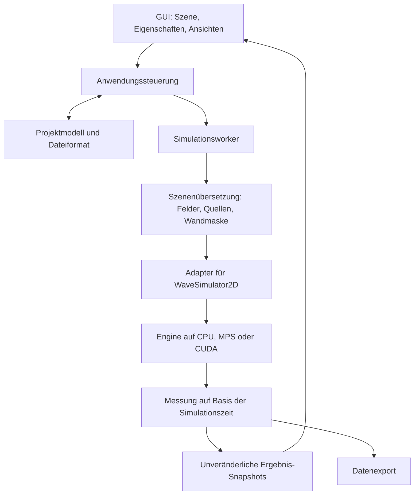

# Wave Studio – Projektplan

Stand: 16. Oktober 2026. Vereinbarter Produktumfang mit den notwendigen Ergänzungen aus der Planprüfung und dem festgelegten Entwicklungsablauf für beide Repositories. Die Teststrategie ist auf wenige aussagekräftige Referenzfälle und zentrale Bedienabläufe begrenzt. Noch keine Implementierung oder Laufzeitvalidierung; numerische Grenzwerte und Leistungsbudgets werden im Prototyp bestimmt.

## 1. Ziel und festgelegte Anforderungen

Wave Studio wird eine Desktop-Anwendung zum freien Aufbauen, Simulieren und Auswerten optischer Wellenexperimente in zwei Dimensionen. Der erste Schwerpunkt liegt auf anschaulichen Experimenten für Lernen und Lehre. Spätere quantitative Anwendungen sollen auf überprüften Ergebnissen aufbauen.

| Aspekt | Vereinbarter Stand |
| --- | --- |
| Produkt | **Wave Studio**, vollständig lokal und offline nutzbar; Projekte als Dateien austauschen |
| Zielgruppe | Grundkenntnisse in Optik, keine Programmierkenntnisse erforderlich; zunächst der Nutzer als erster Anwender |
| Plattformen | **macOS, Windows und Linux**, fertige Anwendungspakete ohne separat zu installierendes Python |
| Sprache und Gestaltung | **Englische Oberfläche**, einschließlich Meldungen, Hilfen und Beispielen; weitere Sprachen technisch vorbereitet; helles und dunkles Farbschema |
| Arbeitsweise | Ein geöffnetes Projekt und **eine aktive Simulation**; keine parallelen Simulationen, auch nicht als späterer Ausbau |
| Szeneneditor | Eigene Aufbauten frei erstellen oder Beispiele öffnen; Objekte mit der Maus platzieren und Parameter numerisch bearbeiten; Undo/Redo |
| Erste mitgelieferte Beispiele | Doppelspalt, Brechung an einer Grenzfläche und Fokussierung durch eine symmetrisch bikonvexe Linse |
| Quellen und Materialien | Kontinuierliche Punkt- und Linienquellen; geometrische Materialbereiche mit Brechungsindex und optionaler Dämpfung |
| Spalte | Aus rechteckigen Wandstücken zusammensetzen; kein eigenes Blendenwerkzeug erforderlich |
| Einheiten | Geometrien in Vielfachen einer festen Referenzwellenlänge des Projekts; Änderungen der Quellenwellenlänge ändern keine Objektgrößen oder Positionen |
| Darstellung | Eine umschaltbare Hauptansicht und eine optionale zweite Ansicht mit synchronisiertem Ausschnitt desselben Laufs |
| Auswertung | Relative Intensitätsprofile, Abstände und Winkel; ein festgehaltenes Detektorprofil mit dem aktuellen Profil vergleichen |
| Speichern und Export | Projektdateien einschließlich festgehaltener Referenzprofile, PNG und CSV; begrenzte automatische Wiederherstellung des Aufbaus |
| Qualität | **Preview**, **Balanced**, **High Quality** und aufklappbare Experteneinstellungen; keine automatische Gitteränderung während eines Laufs |
| Ressourcen | Sparsamer Standardbetrieb; optional höhere Rechenleistung; bedienbare GUI und sinnvoller CPU-Betrieb auch auf schwächerer Hardware |
| Referenzhardware | **MacBook mit Apple M1 und 8 GB RAM**; Windows- und Linux-Rechner für Tests vorhanden |
| Paketgröße | Eine größere Installationsdatei ist akzeptabel, wenn die Anwendung im Betrieb sparsam läuft |
| Technik | Python, PySide6, PyQtGraph und der Fork [flsmn/WaveSimulator2D](https://github.com/flsmn/WaveSimulator2D) als separat paketierte, versionierte Engine-Abhängigkeit |

Die Beispiele sind Einstiegshilfen und Referenzfälle, keine Beschränkung des Editors auf drei Experimente. Version 0.1 wird auf kompakte Lehrversuche optimiert; größere Aufbauten sind im Rahmen der verfügbaren Ressourcen und ausreichender Auflösung möglich. Ein homogener Strahl ist erst für spätere Versionen vorgesehen.

Die verbindliche Bedienregel für Pause, Bearbeiten und den ausschließlich manuell ausgelösten Run steht in Abschnitt 4. Numerische Implementierungsentscheidungen werden im Prototyp überprüft. Es gibt keinen festen Zieltermin; Aufwandsschätzungen folgen nach dem ersten Entwicklungsabschnitt.

## 2. Was die vorhandene Engine mitbringt

Gesichtet wurden der öffentliche Fork sowie die lokale Engine-Kopie mit Basis-Commit `5620234f539b1be3974f4dca122c16f272845271`. Sie liegt nach der Umstrukturierung unter `/Users/sebastian/Documents/VSCode/WaveStudioApp/WaveSimulator2D`; das Anwendungsrepository liegt daneben unter `WaveStudioApp/WaveStudio`. Die numerischen Befunde stammen aus statischer Codesichtung. Die Umstrukturierung erhält den vorhandenen Git-Verlauf und Arbeitsstand; im bestehenden Testskript wird lediglich der absolute Importpfad durch den tatsächlichen Skriptordner ersetzt.

| Vorhanden | Bedeutung für Wave Studio |
| --- | --- |
| Python und PyTorch, Gerätewahl für CUDA, MPS und CPU | Gute Grundlage für gemeinsame Anwendungslogik auf drei Betriebssystemen |
| Skalares Feld mit expliziter zeitlicher Fortschreibung und 3×3-Faltung | Numerischen Kern weiterverwenden; Modellgrenzen und Genauigkeit dokumentieren |
| Punkt- und Linienquellen, Brechungsindexfelder, Polygone und Rechtecke | Quellen und Materialobjekte in einem Szeneneditor anbieten |
| Dämpfung und gedämpfte Randzone | Randreflexionen vermessen und geeignete Voreinstellungen entwickeln |
| Feldansicht, geglättetes Feldquadrat, OpenCV-Beispiele | Visualisierungsideen übernehmen und in eine gemeinsame GUI integrieren |

Quellen: [Simulationskern](https://github.com/flsmn/WaveSimulator2D/blob/main/wave_sim2d/wave_simulation.py), [Quellenobjekte](https://github.com/flsmn/WaveSimulator2D/blob/main/wave_sim2d/scene_objects/source.py), [Materialobjekte](https://github.com/flsmn/WaveSimulator2D/blob/main/wave_sim2d/scene_objects/static_refractive_index.py), [Visualisierung](https://github.com/flsmn/WaveSimulator2D/blob/main/wave_sim2d/wave_visualizer.py).

Konkrete Aufgaben aus der Codesichtung:

- Gerätewahl zentralisieren und explizit übergeben: `StaticRefractiveIndexPolygon` berücksichtigt gegenwärtig MPS und CPU, während der Kern auch CUDA auswählt. Alle Objekte müssen das gewählte Gerät verwenden; CUDA wird erst bei tatsächlich angebotener Unterstützung geprüft.
- Frequenzkonvention klären: Die Quellen verwenden `sin(phase + frequency * t)`; der Parameter entspricht damit einer Kreisfrequenz in den internen Zeiteinheiten.
- Vollständigen Reset einführen: `reset_time()` setzt derzeit nur die Zeit zurück. Für einen neuen Versuch müssen auch Felder und Messhistorien zurückgesetzt werden.
- Intensitätsmittelung aus dem Visualisierer in die Messlogik verschieben. Ihre Zeitbasis soll die Simulationszeit sein.
- Initialfeld-Verarbeitung prüfen: Die Formprüfung greift auf `shape[2]` zu, obwohl das Simulationsfeld zweidimensional ist.
- Polygon-Rasterisierung korrigieren: Die Maske verwendet `float32` mit `cv2.LINE_AA`, obwohl OpenCV diese Kantenglättung nur für 8-Bit-Bilder unterstützt. Subpixelbehandlung für die numerische Geometrie ausdrücklich festlegen; sichtbare Kantenglättung allein belegt keine korrekte Materialmittelung.
- Veraltete Polygonmasken verhindern: Der Cache prüft nur die Feldgröße. Bei Geometrieänderungen entweder neue numerische Objekte erzeugen oder den Cache zuverlässig verwerfen.
- Paketierung ergänzen und portable Ausführung der vorhandenen Tests prüfen. Der feste Importpfad in `test_comprehensive.py` wurde bei der Umstrukturierung bereits auf den Skriptordner umgestellt. Die begrenzte Teststrategie steht in Abschnitt 8.

Diese Punkte sind statische Befunde, keine hier reproduzierten Laufzeitfehler. Zur Einschränkung von `LINE_AA`: [OpenCV-Zeichenfunktionen](https://docs.opencv.org/4.13.0/d6/d6e/group__imgproc__draw.html).

### Vorhandene Materialfunktionen im Detail

Die Engine beschreibt Materialwirkungen hauptsächlich über zwei räumliche Felder: Brechungsindex beziehungsweise lokale Wellengeschwindigkeit und numerische Dämpfung. Eine Datenbank konkreter Stoffe mit gemessenen, wellenlängenabhängigen Eigenschaften ist im gesichteten Code nicht enthalten.

| Vorhandene Klasse | Tatsächliche Funktion | Bedeutung für den Editor |
| --- | --- | --- |
| `StaticRefractiveIndex` | Übernimmt eine zweidimensionale Karte des Brechungsindex; begrenzt n auf 0,9 bis 10 und setzt den internen Geschwindigkeitsparameter auf 1/n. | Grundlage für Materialbereiche und räumlich veränderliche Indexkarten. Der implementierte Wertebereich ersetzt keine Genauigkeitsvalidierung. |
| `StaticRefractiveIndexPolygon` | Zeichnet einen Bereich mit einem Brechungsindex anhand von Polygonpunkten. | Eine Materialregion mit frei definierbarer polygonaler Form. |
| `StaticRefractiveIndexBox` | Erzeugt ein drehbares Rechteck als Polygon. | Geometrische Variante desselben Materialmodells; keine zusätzliche Materialart. |
| `StaticDampening` | Übernimmt eine räumliche Dämpfungskarte mit Faktoren von 0 bis 1 und ergänzt eine gedämpfte Randzone. Der Faktor wirkt in der Fortschreibung auf die zeitliche Feldänderung; 1 bedeutet keine Dämpfung durch diesen Faktor. | Absorbierende Bereiche sind rechnerisch bereits möglich. Für frei platzierbare Absorber fehlen vor allem komfortable Formobjekte und Editorbedienung. Ein Dämpfungsfaktor ist noch kein kalibrierter physikalischer Absorptionskoeffizient. |
| `StaticImageScene` | Liest Brechungsindex aus Rot, Quellen aus Grün und Dämpfung aus Blau eines Bildes; benutzt intern die vorhandenen Index- und Dämpfungsklassen. | Alternative Szenenbeschreibung, keine weitere Materialphysik. Bildimport ist dadurch als spätere Erweiterung möglich. |
| `StrainRefractiveIndex` | Berechnet einen veränderlichen Index aus einem Grundwert und dem Betrag diskreter räumlicher Ableitungen des aktuellen Feldes. | Spezielles feldabhängiges Modell. Es wird für Version 0.1 nicht übernommen und ist kein bereits validiertes allgemeines Modell nichtlinearer Optik. |

Quellen: [Brechungsindexklassen](https://github.com/flsmn/WaveSimulator2D/blob/main/wave_sim2d/scene_objects/static_refractive_index.py), [Dämpfung](https://github.com/flsmn/WaveSimulator2D/blob/main/wave_sim2d/scene_objects/static_dampening.py), [Bildszene](https://github.com/flsmn/WaveSimulator2D/blob/main/wave_sim2d/scene_objects/static_image_scene.py), [feldabhängiger Index](https://github.com/flsmn/WaveSimulator2D/blob/main/wave_sim2d/scene_objects/strain_refractive_index.py).

Reflektierende Strukturen kommen bereits als Indexsprünge vor. Das [Resonatorbeispiel](https://github.com/flsmn/WaveSimulator2D/blob/main/wave_sim2d/examples/example4.py) verwendet zwei Rechtecke mit hohen Indexwerten. Der übergebene Wert 100 wird durch die Materialklasse auf 10 begrenzt. Diese Bereiche sind hochbrechende Regionen des skalaren Modells. Eine eigene frei platzierbare Klasse für eine ideal reflektierende Wand oder ein Materialmodell metallischer Spiegel ist im gesichteten Code nicht vorhanden.

Materialumfang für Version 0.1: Die vorhandenen Index- und Dämpfungsfelder werden als Eigenschaften geometrischer Objekte zugänglich gemacht. Zusätzlich erhalten einfache rechteckige Wände eine explizite Hindernisbedingung für frei aufgebaute Spaltversuche; siehe Abschnitt 4. Weitergehende Spiegelmodelle bleiben ein späterer Ausbau.

## 3. Physikalischer Umfang

Version 0.1 verwendet ein **skalares, lineares 2D-Wellenmodell mit statischen Materialien**. Geeignete erste Experimente sind Interferenz, Beugung und Brechung innerhalb des validierten Modellbereichs.

Eine allgemeine Polarisationssimulation, reale metallische Spiegel, Materialdispersion und absolute Leistungsangaben sind außerhalb von Version 0.1. Die Feldgröße und die Grenzen der zweidimensionalen Idealisierung werden verständlich dokumentiert; eine 2D-Linse ist keine vollständige Simulation einer dreidimensionalen Laborlinse. Das bestehende Backend bleibt der Ausgangspunkt.

Vor physikalisch beschrifteten Eingaben werden Raum- und Zeitskalierung, Kreisfrequenz, Wellenlänge und numerische Ausbreitungsgeschwindigkeit gemeinsam definiert. Der 3×3-Kern ergibt bei Einheitsgitter im Langwellenlimit den führenden Term 0,316·(u_xx + u_yy); der Kommentar zur Geschwindigkeit von 1 Pixel/Zeitschritt ist daher keine ausreichende Kalibrierung. Die Fortschreibung verwendet bereits (c·dt)². Stabilität und numerische Dispersion werden für dieses Schema bestimmt; Grenzen anderer Differenzenschemata werden nicht ungeprüft übernommen. Das sind analytische Codebefunde, keine Laufzeitmessungen.

Für Punkt- und Linienquellen wird eine additive Einspeisung als bevorzugter Ansatz in M0 festgelegt und geprüft. Zeitpunkt der Einspeisung, Bedeutung der Amplitude und Skalierung mit Gitter und Zeitschritt müssen zusammenpassen; ein bloßes Ersetzen von `=` durch `+=` reicht nicht. Die bisherigen Quellen schreiben Feldwerte vor und können ankommende Wellen beeinflussen. Überlappende additive Quellen werden nach derselben definierten Regel summiert; Quellen innerhalb undurchlässiger Wände sind ungültig.

Die Referenzversuche verwenden eine zur tatsächlichen Beleuchtung passende Auswertung. Zunächst werden Punkt- und Linienquellen mit ausreichendem Abstand zu Quellenenden und geeigneter Randdämpfung verwendet. Eine Linienquelle gilt dadurch nicht automatisch als einseitig. Quellenlänge, Position und Messbereich werden in den Beispielen festgehalten. Ein homogener Strahl bleibt außerhalb von Version 0.1. Falls ein Referenzfall mit den vorgesehenen Quellen nicht zuverlässig gelingt, werden zuerst Aufbau und Auswertung geprüft; eine erforderliche Erweiterung des Quellenumfangs wird gesondert entschieden.

Bei Qualitätswechseln bleiben Referenzlänge, Geometrie, Quellenparameter und beabsichtigte Dämpfung gleich. Der bisherige Dämpfungsfaktor wirkt pro Zeitschritt; seine Umrechnung und die räumliche Breite von Dämpfungsbereichen müssen deshalb zur gewählten Raum- und Zeitskala passen.

Bestätigt für die erste Oberfläche: Geometrien in Vielfachen einer Referenzwellenlänge. Quellenwellenlängen beziehen sich auf das Referenzmedium; die Wellenlänge im Material ergibt sich aus dem validierten Modell. Die dazu passende normierte Zeitskala wird im Modell festgelegt. Eingaben in µm und fs folgen nach nachgewiesener Skalierung. Die sichtbare Animation ist eine verlangsamte Darstellung der Simulationszeit.

Als Intensitätsansicht zunächst das zeitlich gemittelte Feldquadrat in relativen Einheiten verwenden und entsprechend beschriften. Farbsättigung und Helligkeit verändern ausschließlich die Darstellung. Für Messwerte wird das unbeschnittene Feld ausgewertet. Die vorhandene gedämpfte Randzone wird als solche bezeichnet; die Implementierung ist noch keine nachgewiesene reflexionsfreie PML. Siehe [Dämpfungscode](https://github.com/flsmn/WaveSimulator2D/blob/main/wave_sim2d/scene_objects/static_dampening.py); zur fachlichen Einordnung von Einheiten, Gittern und PML die [Meep-Dokumentation](https://meep.readthedocs.io/en/latest/Introduction/).

## 4. Erste nutzbare Version

Erster durchgängiger Entwicklungs- und Abnahmefall: **Doppelspalt aufbauen → Simulation starten → Feld und Interferenzmuster beobachten → Detektorprofil exportieren → Projekt später wieder öffnen.** Dieser Ablauf prüft das Zusammenspiel der Funktionen; der Szeneneditor ermöglicht darüber hinaus eigene Versuchsaufbauten.

| Bereich | Umfang für Version 0.1 |
| --- | --- |
| Projekt | Ein geöffnetes Projekt; neu, öffnen, speichern; drei Beispielprojekte |
| Szene | Kontinuierliche Punkt- und Linienquelle mit Wellenlänge, Amplitude und Phase; Materialrechteck und Polygon mit Brechungsindex und optionaler Dämpfung, auch als frei platzierbare absorbierende Bereiche; symmetrisch bikonvexe Linse mit Krümmung, Öffnung, Brechungsindex und optionaler Dämpfung; rechteckige Wände zum Zusammensetzen von Einzel- und Doppelspalten; Randdämpfung |
| Bearbeitung | Objekte hinzufügen, auswählen, verschieben, duplizieren und löschen; Parameter im Eigenschaftenbereich; Undo/Redo |
| Steuerung | Eine aktive Simulation; Run, Pause, Einzelschritt, vollständiger Reset; physikalische Szene nur vor dem Start oder pausiert editierbar; nach Änderungen angehalten bleiben, neuer Lauf ausschließlich durch manuellen Klick auf Run |
| Darstellung | Umschaltbare Hauptansicht für Feld, relatives gemitteltes Feldquadrat und Materialkarte; Zoom, Verschieben, Farbskala; zuschaltbare zweite Ansicht mit synchronisiertem Ausschnitt |
| Messung | Punktdetektor und Detektorlinie für relative Intensitätsprofile; Messwerkzeuge für Abstände und Winkel; festgehaltenes Referenzprofil zum Vergleich mit dem aktuellen Lauf |
| Export | PNG der Ansicht und CSV des Detektorprofils mit Einheiten, Messfenster und zugehörigen Parametern; Projektdateien für Versuchsaufbau und festgehaltene Referenzprofile |
| Rechenumgebung | CPU als Basis; automatische Geräteerkennung und manuelle Auswahl verfügbarer, getesteter Backends |
| Qualität | Preview, Balanced, High Quality; Experteneinstellungen; gleichbleibende numerische Auflösung innerhalb eines Laufs |
| Betrieb | Vollständig lokal und offline; sparsamer Standardmodus und optional höhere Rechenleistung; für schwächere Hardware abgestimmte Beispiele |

Ein Einzelspalt besteht aus zwei Wandstücken, ein Doppelspalt aus drei Wandstücken mit zwei Öffnungen dazwischen. Ein eigener Blendentyp oder ein spezielles Blendenwerkzeug wird nicht benötigt. Als einfaches Wandmodell wird in M0 eine Dirichlet-Bedingung (u = 0 im Hindernisbereich) umgesetzt und am Spaltversuch geprüft. Sie beschreibt eine ideal reflektierende, undurchlässige Wand; ein Material mit hohem Brechungsindex oder Dämpfung ersetzt diese Bedingung nicht. Die Wandstücke werden so angeordnet, dass unbeabsichtigte Wege um ihre äußeren Enden den Referenzversuch nicht verfälschen.

Für die symmetrisch bikonvexe Linse werden Krümmung, Öffnung, Dickenregel und gültige Parameter vor dem Linsenwerkzeug eindeutig festgelegt. Die geometrische Kontur bleibt bei Qualitätswechseln dieselbe.

Die ersten mitgelieferten Beispielversuche und Referenzfälle für die Entwicklung sind Doppelspalt, Brechungsgrenze und Fokussierung durch eine Linse. An ihnen werden Editor, Engine, Darstellung und Auswertung entwickelt und überprüft. Sie ergänzen den frei bedienbaren Szeneneditor. Einzelne Punktquelle und zwei kohärente Quellen dienen zusätzlich als einfache Einführungs- und Referenzfälle.

Während eines Laufs bleiben Darstellung und passive Detektoren veränderbar. Physikalische Geometrie, Materialien, Quellen und Gitter lassen sich nur vor dem ersten Start oder nach Pause bearbeiten. Solche physikalischen Änderungen markieren den bisherigen Lauf als überholt; die Anzeige darf das alte Feld nicht als Ergebnis des neuen Aufbaus ausgeben. Die Simulation bleibt nach der Bearbeitung angehalten. Weder das Loslassen der Maus noch das Bestätigen eines Wertes oder das Schließen eines Bearbeitungsdialogs startet sie automatisch, auch wenn sie vor der Pause lief. Erst der nächste manuelle Klick des Nutzers auf Run initialisiert Felder und aktuelle Messungen neu und startet den geänderten Versuch. Pause und ein manueller Klick auf Run ohne physikalische Änderungen setzen den bisherigen Lauf fort. Gespeicherte Referenzprofile bleiben erhalten. Die Trennung zwischen physikalischen Änderungen, Messänderungen und Darstellung steht in Abschnitt 6. Ein späterer Live-Modus für ausgewählte Quellenparameter wird ausdrücklich kenntlich gemacht.

Spätere Versionen: freies Malen, zusätzliche Linsenformen und Prismen, weitergehende Spiegelmodelle und ein optionales Komfortwerkzeug zur automatischen Anordnung von Spalten, eine Quelle für einen homogenen Strahl (Profil und Einstrahlrichtung später spezifizieren), Gaußstrahlen, Pulse und weitere Quellformen, Videoexport, fortsetzbare Simulationszustände, sequenzielle Parameterreihen, Fourier-Auswertung, anspruchsvollere Randbedingungen und zusätzliche physikalische Modelle. Ein Export vollständiger numerischer Felder, beispielsweise als NPZ, ist ein optionaler späterer Ausbau. 3D ist außerhalb des ersten Projektumfangs. Parallele Simulationen gehören nicht zum vorgesehenen Funktionsumfang, auch nicht zum späteren Ausbau.

## 5. Oberfläche und Bedienablauf

Die Produktoberfläche einschließlich Menüs, Parameterbeschreibungen, Beispielen und Meldungen wird auf Englisch gestaltet. Der deutschsprachige Projektplan bleibt ein Arbeitsdokument. Sprachtexte werden zentral verwaltet, um spätere Übersetzungen zu ermöglichen. Einblendbare Detailoptionen sowie ein helles und ein dunkles Farbschema sind bestätigt.

```text
┌───────────────────────────────────────────────────────────────────────┐
│ Wave Studio    File   Edit   View   Examples                           │
├───────────────────────────────────────────────────────────────────────┤
│ Run / Pause   Step   Reset                 Simulation time            │
├────────────────┬─────────────────────────────────┬────────────────────┤
│ Scene          │                                 │ Properties         │
│ + Source       │       Experiment / Wave field   │ Selection          │
│ + Material     │                                 │ parameters         │
│ + Wall         │   Field | Intensity | Material   │                    │
│ + Detector     │                                 │ Grid / Boundary    │
│                │                                 │ Color scale        │
├────────────────┴─────────────────────────────────┴────────────────────┤
│ Detector profile                                       Export data   │
├───────────────────────────────────────────────────────────────────────┤
│ Status   Grid size   Device   Steps/s   Frames/s                       │
└───────────────────────────────────────────────────────────────────────┘
```

Der Einstieg erfolgt über ein Beispiel oder ein leeres Projekt. Objekte erscheinen sowohl auf der Zeichenfläche als auch in der Szenenliste. Änderungen im Eigenschaftenbereich aktualisieren beide. Numerisch ungültige Eingaben werden mit einer konkreten Erklärung am jeweiligen Feld abgefangen. Simulationsgeschwindigkeit und Bildrate werden getrennt angezeigt. Tastaturbedienung, skalierbare Schrift, erkennbare Auswahl und Farbskalen mit Zahlenwerten gehören zur Bediengestaltung.

Die optionale zweite Ansicht übernimmt den sichtbaren Ausschnitt der Hauptansicht. Ein festgehaltenes Detektorprofil bleibt nach einem Neustart als Referenz verfügbar und behält den Szenenstand und die Messparameter seines Ursprungslaufs. Der Vergleich verwendet eine gemeinsame wählbare Skalierung, damit Unterschiede nicht durch getrennte automatische Normierung verdeckt werden.

Beide Ansichten und alle Messdiagramme verwenden dieselbe aktive Simulation. Ein Referenzprofil ist ein gespeichertes Ergebnis und benötigt keinen weiterlaufenden zweiten Simulationslauf.

Die Live-Vorschau ist sofort verfügbar. Gespeicherte Referenzprofile und quantitative CSV-Exporte verwenden ein definiertes endliches Messfenster nach einer Einlaufphase. Beginn, Dauer, Samplezahl und Mittelungsverfahren werden dokumentiert; unterschiedliche Quellenfrequenzen und mögliche Schwebungen sind bei der Fensterwahl zu berücksichtigen. Es gibt keine unbegründete automatische Meldung „eingeschwungen“.

Messungen kennzeichnen einen noch laufenden Messvorgang, ein abgeschlossenes Fenster, eine festgehaltene Referenz oder ein überholtes Ergebnis. Gespeichert werden die unnormalisierten relativen Messwerte mit Ortskoordinaten und Parametern. Vergleiche verschiedener Gitter verwenden eine gemeinsame physikalische Ortsachse; eine Interpolation verändert nicht die gespeicherten Originalwerte. Referenzen entstehen ausdrücklich auf Nutzerwunsch; die Historie bleibt begrenzt.

Passive Detektoren beeinflussen die Wellenausbreitung nicht und dürfen auch während eines laufenden Versuchs verschoben werden. Beim Ziehen wird die neue Position zunächst als Vorschau dargestellt. Erst beim Loslassen beziehungsweise Bestätigen einer gültigen Position übernimmt die Messlogik die Änderung und beginnt für diesen Detektor ein neues Messfenster. Messwerte verschiedener Positionen werden nicht vermischt. Wellenfeld, Simulationszeit, andere Detektoren und festgehaltene Referenzprofile bleiben erhalten. Ist die Simulation pausiert, bleibt sie pausiert; die neue Messung sammelt erst bei weiteren ausdrücklich ausgelösten Simulationsschritten Werte.

## 6. Technik und Architektur

Bestätigte technische Grundlage: **Python + PySide6 + PyQtGraph + bestehende PyTorch-Engine.** Für die erste GUI werden Qt Widgets empfohlen; die konkrete Implementierung wird im Prototyp geprüft.

PySide6 bietet die offiziellen Qt-Bindings für Python. PyQtGraph bietet Bilddarstellung mit Farbskalen und eignet sich als erster Kandidat für Feldansicht und Messdiagramme. Die konkrete Leistung wird mit einem Prototyp geprüft. Quellen: [Qt for Python](https://doc.qt.io/qtforpython-6/), [PyQtGraph ImageItem](https://pyqtgraph.readthedocs.io/en/latest/api_reference/graphicsItems/imageitem.html).



Das Projektmodell beschreibt Quellen, Geometrie, Materialien, Gitter und Detektoren unabhängig von Qt und GPU-Tensoren. Eine kleine Szenenübersetzung (Scene Compiler) erzeugt daraus die numerischen Materialfelder, Quellenbeschreibungen und Wandmasken. Sie gehört in das vorhandene Simulationsmodul und benötigt kein eigenes Framework. Der Adapter übernimmt diese Daten und bietet wenige klare Operationen: Szene laden, Schritte berechnen, Ergebnis lesen und vollständig zurücksetzen.

Für Materialüberlappungen gilt eine sichtbare Reihenfolge: Das oberste Materialobjekt bestimmt Brechungsindex und Dämpfung gemeinsam; ohne Dämpfung ist dessen Bereich ungedämpft. Die äußere Dämpfungszone wird separat angewendet. Wände setzen ihre Hindernisbedingung unabhängig von darunterliegenden Materialien durch. Bei Änderungen an Geometrie, Materialien oder Gitter werden die betroffenen numerischen Daten vor dem nächsten Lauf neu erzeugt. Rasterisierung und Materialmittelung müssen zum Solver passen; eine bestimmte Mittelung von n, c oder c² wird nicht ohne Begründung festgeschrieben.

Simulationsbereich, sichtbarer Ausschnitt und äußere Dämpfungszone sind getrennt. Zoomen und Fenstergröße verändern die Simulation nicht. Quellen und Versuchsobjekte werden für den ersten Umfang im nutzbaren Innenbereich angeordnet.

Die Anwendung verwaltet genau eine aktive Engine-Instanz. Beim Wechsel des Projekts wird der bisherige Lauf beendet und dessen Zustand freigegeben. Ein zweiter Simulationslauf wird weder für eine zweite Ansicht noch für Referenzprofile gestartet. Interne CPU-/GPU-Parallelität zur Beschleunigung dieses einen Laufs bleibt möglich.

Der Simulationsworker läuft zunächst in einem separaten Qt-Thread. Er besitzt die Engine allein und verarbeitet Befehle zwischen begrenzten Schrittblöcken. Die GUI erhält unveränderliche Momentaufnahmen; eine begrenzte Übergabe hält höchstens den neuesten noch nicht dargestellten Frame bereit. Messungen laufen unabhängig davon weiter. Das entspricht dem Qt-Muster für ausgelagerte Arbeit; die konkrete Thread-Organisation muss Pause und Abbruch zeitnah zulassen. Quelle: [QThread](https://doc.qt.io/qtforpython-6/PySide6/QtCore/QThread.html).

Für Version 0.1 ist ein einfacher, gemessener GPU-zu-CPU-Transfer für die Anzeige vorgesehen. Daten werden nur mit der benötigten Anzeigerate übertragen. Detektoren werden möglichst auf dem Rechengerät ausgewertet und ihre Ergebnisse in begrenzten Blöcken übertragen; eine Synchronisation pro Simulationsschritt wird vermieden. Ein eigener GPU-Renderer oder separater Simulationsprozess wird erst bei einem nachgewiesenen Engpass eingeführt.

Die Laufsteuerung unterscheidet bereit, laufend, pausiert, physikalischer Aufbau geändert und Fehler. `scene_revision` bezeichnet ausschließlich die Revision der physikalischen Szene und ihrer numerischen Simulationsparameter. Sie erhöht sich nur bei Änderungen, die die Wellenausbreitung oder ihre Berechnung beeinflussen. Passive Detektoren gehören zur Messkonfiguration, Farbskala und Ausschnitt zur Darstellung.

| Änderung | `scene_revision` erhöhen? | Wirkung auf Simulation und Messung |
| --- | --- | --- |
| Wand, Linse oder Material bewegen bzw. Materialwerte ändern | Ja | Nur vor dem Start oder pausiert; ein neuer Lauf ist erforderlich und beginnt erst durch manuellen Run. |
| Quelle verschieben | Ja | Nur vor dem Start oder pausiert; neuer Lauf durch manuellen Run. |
| Wellenlänge, Amplitude oder Phase einer Quelle ändern | Ja | Nur vor dem Start oder pausiert; neuer Lauf durch manuellen Run. |
| Gitterauflösung, Zeitschritt, Simulationsbereich oder Randbedingungen ändern | Ja | Nur vor dem Start oder pausiert; neuer Lauf durch manuellen Run. |
| Passiven Detektor verschieben oder seine Abtastung bzw. sein Messfenster ändern | Nein | Auch während eines Laufs möglich; nur die aktuelle Messung dieses Detektors zurücksetzen. |
| Farbskala oder Helligkeit ändern | Nein | Nur Darstellung; keine Messung zurücksetzen. |
| Ansicht zoomen oder verschieben | Nein | Nur Darstellung; keine Messung zurücksetzen. |

Die gleiche Einteilung gilt für Hinzufügen, Löschen und Undo/Redo: Physikalische Objekte verändern die physikalische Revision, passive Detektoren nur die jeweils betroffene Messung. Das Hinzufügen eines Detektors startet dessen eigene Messung, das Löschen beendet sie. Diese Änderungen versetzen den Simulationslauf nicht in den Zustand „physikalischer Aufbau geändert“. Der Speicherstatus des Projekts wird davon getrennt geführt: Änderungen an gespeicherten Detektor- oder Anzeigeeinstellungen können ebenfalls ungespeicherte Projektänderungen sein.

Eine `run_id` kennzeichnet den einzelnen Simulationslauf; reine Detektor- oder Darstellungsänderungen verändern sie nicht. Jede Detektormessung erhält eine eigene Messrevision, damit verzögert eintreffende Werte der alten Position oder Konfiguration verworfen werden können. Der Worker übernimmt Messänderungen zwischen Rechenblöcken; ab diesem Zeitpunkt werden ausschließlich Werte für die neue Messrevision gesammelt. Alte Frames und Messwerte dürfen weder einem neuen Lauf noch einem neuen Messfenster zugeordnet werden.

Die Zustandsübergänge folgen der Bedienregel aus Abschnitt 4. Step führt im pausierten, zum physikalischen Aufbau passenden Lauf genau einen Schritt aus und startet keinen Dauerlauf. Nach einer physikalischen Änderung bleibt Step bis zum nächsten manuellen Run deaktiviert. Reset löscht aktuelle Felder und Messungen und lässt die Anwendung angehalten; festgehaltene Referenzen bleiben erhalten.

Ungültige Eingaben werden vor der Übernahme mit einer konkreten Erklärung abgewiesen; die bisher gültige Konfiguration bleibt bestehen. Ein gültiger laufender Versuch und seine Messungen laufen unverändert weiter. Ein Start mit ungültigen Simulationsparametern wird verhindert. Fehler, die eine sichere Fortsetzung der Simulation verhindern, etwa Speichermangel im Solver, Backend-Ausfall oder numerisch ungültige Felder, stoppen dagegen den betroffenen Lauf und erhalten die bearbeitete Szene. Auch nach Fehlerbehebung oder Gerätewechsel beginnt die Berechnung erst wieder auf Nutzeraktion. Die maximale Rechenblockdauer wird an der tatsächlichen Pause-Latenz ausgerichtet.

Die Entwicklung erfolgt in zwei eigenständigen Git-Repositories mit getrennten Verantwortlichkeiten:

- **WaveStudio:** Desktop-Anwendung, GUI, Szeneneditor und Auswertungsfunktionen.
- **WaveSimulator2D:** Simulations-Engine und numerische Berechnungen. Numerische Korrekturen gehören in diesen bestehenden Engine-Fork.

Beide Repositories liegen als eigenständige Git-Repositories im gemeinsamen Arbeitsbereich `WaveStudioApp/`:

```text
WaveStudioApp/                         # Gemeinsamer Arbeitsbereich, kein übergeordnetes Git-Repository
├── WaveStudioApp.code-workspace       # Öffnet beide Repositories gemeinsam
├── WaveSimulator2D/                   # Repository 1: Simulations-Engine
│   └── .git/
└── WaveStudio/                        # Repository 2: Desktop-Anwendung
    ├── .git/
    ├── PRD.md
    ├── PROJECT_PLAN.md
    └── DEVELOPMENT_PLAN.md
```

Die Planungsdokumente werden im Anwendungsrepository `WaveStudio/` versioniert. Die gemeinsame Workspace-Datei liegt eine Ebene darüber. Während der Entwicklung wird die Engine in der Python-Umgebung von WaveStudio als **lokal editierbares Python-Paket** eingebunden, sodass Änderungen am Engine-Quellcode direkt in Wave Studio getestet werden können.

Änderungen werden je Repository getrennt über Git versioniert. Repositoryübergreifende Anpassungen müssen mit den zusammengehörigen Ständen beider Repositories gemeinsam getestet werden. Dafür werden die betroffenen Kernprüfungen und zentralen Bedienabläufe im begrenzten Umfang aus Abschnitt 8 verwendet.

Für Releases wird die Engine weiterhin separat paketiert und an eine feste Version gebunden. Die ausgelieferte Anwendung benötigt keinen benachbarten Engine-Quellordner. Keine dauerhafte Kopie des Engine-Quellcodes in GUI-Dateien und keine Abhängigkeit von einem beweglichen `main` für Releases.

Vorgeschlagene Paketstruktur innerhalb des Anwendungsrepositories `WaveStudioApp/WaveStudio/`:

```text
src/wave_studio/
    app.py
    domain/       # Szene, Einheiten, Validierung
    simulation/   # Adapter, Worker, Laufsteuerung
    analysis/     # Detektoren, Mittelung, Ergebnisse
    ui/           # Fenster, Editor, Eigenschaften, Plots
    persistence/  # Projektformat und Datenexport
examples/
tests/
docs/
pyproject.toml
```

Projektformat für den Anfang: versioniertes JSON, beispielsweise `experiment.wave.json`, mit stabilen Objekt-IDs und definierten Überlappungsregeln. Die Projektdatei enthält Aufbau, Anzeigeeinstellungen und festgehaltene Referenzprofile samt Messparametern. Die Aufzeichnung bleibt begrenzt; vollständige Felddaten und fortsetzbare Simulationscheckpoints sind spätere Funktionen. Eine automatische Wiederherstellungsdatei schützt den bearbeiteten Aufbau. Speichern ersetzt die Zieldatei atomisch, damit ein fehlgeschlagener Schreibvorgang nicht die letzte gültige Datei zerstört. Beschädigte Dateien und unbekannte Formatversionen werden verständlich abgewiesen, ohne das offene Projekt zu überschreiben. Migrationen werden erst bei einer tatsächlichen Formatänderung benötigt.

Zu einem Ergebnis gehören mindestens Szenenstand, Lauf-ID, Engine-Version, Gitter, Zeitschritt, Laufdauer, Backend, Datentyp, Messfenster und Abtastung. Gemeinsame Wiederholbarkeit wird innerhalb dokumentierter numerischer Toleranzen erwartet; Bitgleichheit zwischen GPU und CPU ist kein Ziel.

## 7. Plattformen, Leistung und Auslieferung

CPU-Betrieb ist die gemeinsame Basis für alle drei Betriebssysteme. MPS wird auf dem M1-Referenzrechner geprüft. CUDA wird für Windows/Linux nur dann als unterstützt angeboten, wenn passende NVIDIA-Testhardware verfügbar ist und der kurze Backendvergleich bestanden wurde; es ist keine Voraussetzung für Version 0.1. Weitere GPU-Systeme sind nicht zugesagt.

Der erste Referenzrechner ist das MacBook des Nutzers mit Apple M1 und 8 GB RAM. Zusätzlich stehen ein Windows- und ein Linux-Rechner zum Testen zur Verfügung. Deren Betriebssystemversionen, Prozessoren, Arbeitsspeicher und GPUs müssen noch erfasst werden. Auf dem Mac werden CPU und MPS verglichen; für die gemeinsame Mindestfunktionalität werden ausdrücklich auch Läufe ohne GPU getestet.

Als zunächst zu bestätigende Build-Matrix schlage ich macOS/ARM64 sowie Windows und Linux/x86-64 vor. Mindestversionen, Linux-Distribution und weitere Architekturen werden nach einem frühen Paketierungstest festgelegt.

Bestätigt sind fertige Anwendungspakete für Version 0.1; PyInstaller wird zunächst als Paketierungskandidat geprüft. Für jedes Betriebssystem wird auf diesem Betriebssystem gebaut und auf einer sauberen Testinstallation gestartet. Die kleinen automatisierten Kernprüfungen laufen zunächst auf CPU; der Umfang der Plattform- und Backendprüfungen ist in Abschnitt 8 begrenzt. PyInstaller erzeugt plattformspezifische Pakete: [Dokumentation](https://pyinstaller.org/en/stable/operating-mode.html).

Bestätigt ist der vollständige Offline-Betrieb. Installation und Dateiaustausch werden so gestaltet, dass die Anwendung für ihre Kernfunktionen keine laufende Netzwerkverbindung benötigt.

Die Engine-Abhängigkeiten werden von der bisherigen Beispielvisualisierung getrennt. Falls OpenCV für die Rasterisierung verwendet wird, ist für die Qt-Anwendung `opencv-python-headless` vorgesehen; damit werden zusätzliche GUI-Bibliotheken vermieden. Die bestehende `requirements.txt` enthält kein CuPy mehr. Unter Linux werden die Systemabhängigkeiten des gewählten Qt-Pakets und die älteste unterstützte Systembasis bei der Paketierung berücksichtigt. Quellen: [OpenCV-Pakete](https://github.com/opencv/opencv-python), [PyInstaller unter Linux](https://pyinstaller.org/en/stable/usage.html).

### Ressourcenverbrauch als frühes Abnahmekriterium

Vorläufiges Interaktionsziel: flüssige Darstellung eines 512×512-Beispiels mit etwa 30 Bildern/s und unter 100 ms Reaktion auf Pause auf dem M1-Referenzrechner. Das ist ein Ziel, keine gemessene Eigenschaft. Bestätigt ist ein sparsamer Standardbetrieb mit begrenztem Rechenaufwand und begrenzter Bildrate; ein optionaler Modus darf mehr Rechenleistung nutzen. Konkrete Grenzen werden im Prototyp gemessen und festgelegt.

Rechenmodus und numerische Qualitätsstufe sind unabhängige Einstellungen: Sparsamer Betrieb kann denselben Simulationslauf langsamer voranschreiten lassen, ohne sein Gitter oder seine Messdefinition zu verändern. Der Standardumfang sind kompakte Lehrversuche; größere Szenen werden vor dem Start auf Ressourcenbedarf und ausreichende Auflösung geprüft.

Der erste Prototyp erfasst Prozess- und Gerätespeicher, Reaktionszeit der GUI, Simulationsschritte/s, Bildrate, CPU-/GPU-Auslastung, Startzeit und Installationsgröße. Messungen erfolgen im Leerlauf, pausiert und unter Simulation, mit einer und zwei Ansichten. Geteilten CPU-/GPU-Speicher auf Apple Silicon bei der Auswertung nicht doppelt zählen. Für numerische Geschwindigkeit und flüssige Anzeige werden getrennte Ergebnisse berichtet.

Der erste Leistungscheck verwendet ein repräsentatives Beispiel mit 512² Zellen; 256² beziehungsweise 1024² werden nur ergänzt, wenn die Grenzen nach unten oder oben geklärt werden müssen. Diese Größen sind keine Qualitätsstufen. Deren Auflösung richtet sich nach der kleinsten Wellenlänge im Material, den kleinsten relevanten Strukturen und der erforderlichen Genauigkeit über den Ausbreitungsweg. Die Grenzen werden anhand der wenigen Referenzszenen aus Abschnitt 8 festgelegt. Vor Run werden unzureichende Auflösung und geschätzter Speicherbedarf angezeigt; das Gitter wird während eines Laufs nicht stillschweigend reduziert. Leistungs- und Speicherbudgets folgen aus dem Prototyp und der schwächeren Testhardware.

Empfohlene Maßnahmen für den Prototyp:

- Berechnung und Darstellung unabhängig begrenzen: Eine Bildratenbegrenzung allein begrenzt den Simulationsaufwand nicht. Ein sparsamer Betriebsmodus soll auch Rechenschritte pro Zeit und gegebenenfalls CPU-Parallelität begrenzen.
- Im pausierten Zustand keine Simulationsschritte berechnen; unveränderte Ansichten nur bei Bedarf neu zeichnen.
- Statische Geometrie- und Materialdaten bei Änderungen vorberechnen und wiederverwenden.
- Feldpuffer wiederverwenden und unnötige Kopien vermeiden; Genauigkeit von Datentypänderungen vorab validieren.
- Nur angeforderte Darstellungen erzeugen; beide Ansichten greifen auf denselben Simulationszustand zurück.
- Frame-Übergabe und Messhistorien begrenzen; vollständige Felder nicht unbegrenzt aufzeichnen. Numerische Messintervalle unabhängig von der Anzeige festlegen und dokumentieren.
- Betriebsbereitschaft ohne unnötige Initialisierung ungenutzter Backends prüfen; Messwerte für Paketgröße und Laufzeitspeicher getrennt bewerten.

Erst gemessene Engpässe begründen Änderungen am Renderer oder Backend. Die bestätigte Engine-Basis und ihre numerische Nachvollziehbarkeit bleiben erhalten.

## 8. Meilensteine und begrenzte Teststrategie

Tests sollen konkrete Fehler mit Auswirkungen auf Simulation, Bedienung oder gespeicherte Arbeit aufdecken. Verwendet werden wenige kleine, wiederverwendbare Szenen und zentrale Abläufe. Es gibt keine pauschale Abdeckungsquote, keine Tests für jedes Oberflächendetail und keine vollständige Kombination aller Gitter, Parameter, Betriebssysteme und Backends. Zusätzliche Tests entstehen nur für ein konkretes Risiko oder einen tatsächlich gefundenen relevanten Fehler.

### Entwicklungsschritte

| Schritt | Ergebnis und Abnahme |
| --- | --- |
| M0a – Numerischen Kern vorbereiten | Einheiten, Stabilitätsbereich, Quellenanregung, vollständiger Reset und einheitliche Gerätewahl festlegen; die für den ersten Umfang relevanten Codefehler beheben. |
| M0b – Physikalische Grundlage prüfen | Die vier unten beschriebenen Referenzszenen ohne GUI ausführbar machen. Freie Ausbreitung, Materialgrenze und Spaltmodell müssen vor dem Ausbau des Editors sinnvoll funktionieren; ein einfacher fester Linsenaufbau prüft die grundsätzliche Eignung frühzeitig. |
| M1 – Durchgängiger Prototyp | Fenster mit Punktquelle, Feldansicht, Run/Pause/Reset und Worker; Bedienbarkeit und sparsamen Betrieb auf M1/8 GB prüfen; erste Pakete auf allen drei Systemen starten. Ein einfacher GUI- und Paketierungsprototyp darf bereits während M0 entstehen. |
| M2 – Szeneneditor | Quellen, Materialien und Wände bearbeiten; Speichern/Laden und Undo/Redo. Laufsteuerung, aktualisierte Raster, Undo/Redo und Speichern/Laden des Aufbaus funktionieren; Messungs- und Exportteile folgen in M3. |
| M3 – Vollständiger Beispielversuch | Doppelspalt aus Wandstücken aufbauen, Intensitätsprofil messen, eine Referenz festhalten und PNG/CSV exportieren. Der Ablauf ist vollständig ohne Python-Code bedienbar. |
| M4 – Version 0.1 | Zuerst die übrigen vereinbarten Funktionen einschließlich Linsenwerkzeug, zweiter Ansicht und Messwerkzeugen fertigstellen; anschließend die Anwendungspakete auf macOS, Windows und Linux kurz abnehmen. |
| Späterer quantitativer Ausbau | Weitergehende Genauigkeitsuntersuchungen und zusätzliche Messgrößen erst mit den entsprechenden Funktionen planen. |

M0 und M1 bilden den ersten Entwicklungsabschnitt. Erst danach folgt eine belastbare Aufwandsschätzung. Die umfangreiche Editorentwicklung setzt die grundlegenden physikalischen Nachweise voraus.

### Vier physikalische Referenzszenen

| Szene | Wesentliche Prüfung |
| --- | --- |
| 1. Freie Ausbreitung und zwei kohärente Quellen | Geschwindigkeit und Wellenlänge mit der definierten Skalierung vergleichen; eine achsparallele und eine diagonale Ausbreitung prüfen. Eine zweite Quelle prüft die erwartete Phasenabhängigkeit und additive Überlagerung. Ein gezielter Rückwellenfall prüft, dass die Einspeisung keine unbeabsichtigte harte Wand bildet. |
| 2. Materialgrenze mit Dämpfungszone | Brechungswinkel für einen einfachen schrägen Einfall mit dem passenden Referenzwert vergleichen. In einer gezielten Variante Restreflexion der Randzone und vergleichbare Dämpfung bei geänderter Auflösung prüfen. |
| 3. Doppelspalt aus rechteckigen Wänden | Außerhalb der Öffnungen kein Durchtritt durch die Wand; Symmetrie und Lage charakteristischer Minima mit einer zur Beleuchtung und Messentfernung passenden Referenz vergleichen. |
| 4. Symmetrisch bikonvexe Linse | Fokussierung und Fokuslage für einen einfachen Aufbau gegen eine begründete Referenz prüfen; sicherstellen, dass eine feinere Rasterung das Ergebnis nicht wesentlich verschiebt. |

Diese Szenen werden für Entwicklung, Beispiele und spätere Fehlerkontrolle wiederverwendet. Die Gitter bleiben klein; die Laufdauer richtet sich nach der benötigten Ausbreitungszeit und dem Messfenster. Gezielt verglichene Auflösungen prüfen die Empfindlichkeit gegenüber dem Gitter; zunächst genügen zwei, eine weitere wird nur bei unklaren Abweichungen benötigt. Analytische Referenzen werden innerhalb ihrer Voraussetzungen benutzt; reine Gitterverfeinerung beweist für sich allein keine physikalische Korrektheit.

Vor der Abnahme werden für die tatsächlich verglichenen Größen und Parameterbereiche begründete Fehlertoleranzen festgelegt. Eine große Parameterstudie oder ein allgemeiner Forschungsnachweis ist für Version 0.1 nicht erforderlich. Fehler außerhalb des validierten Bereichs werden nicht durch pauschale Genauigkeitsversprechen verdeckt.

### Zwei zentrale Programmabläufe

| Ablauf | Wesentliche Prüfung |
| --- | --- |
| 1. Laufsteuerung und Bearbeitung | Starten, pausieren, ohne Änderungen fortsetzen; Szene ändern und Undo/Redo verwenden; dabei angehalten bleiben. Erst manueller Run startet den geänderten Aufbau mit frischen Feldern und aktuellen Messungen. Reset setzt vollständig zurück. Veraltete Frames werden verworfen. Ein verschobenes Material muss auch im numerischen Raster verschoben sein. |
| 2. Speichern, Messen und Exportieren | Einen selbst aufgebauten Versuch samt Referenzprofil speichern und ohne Parameterverlust laden; PNG und CSV ausgeben. Einen passiven Detektor während des Laufs verschieben: Feld und Lauf bleiben erhalten, nur seine Messung beginnt ohne alte Positionsdaten neu; Darstellungsänderungen setzen keine Messung zurück. Messwerte hängen nicht von der Darstellungsrate ab, Profile behalten ihre Ortsachse und Metadaten. Eine beschädigte oder unbekannte Datei darf das offene Projekt nicht ersetzen; ein fehlgeschlagener Speichervorgang lässt die letzte gültige Datei bestehen. |

Deterministische Kernlogik wird möglichst ohne GUI automatisiert geprüft. Die sichtbare Bedienung wird zunächst anhand dieser kurzen Abläufe manuell abgenommen; GUI-Automatisierung wird nur ergänzt, wenn sie einen konkreten wiederkehrenden Fehler zuverlässig abfängt. Die zusätzliche frei aufgebaute Szene kann aus zwei Quellen mit veränderbarer Phase bestehen; dafür ist kein weiterer eigener Testfall nötig.

### Leistung, Backends und Anwendungspakete

- Einen repräsentativen Lauf auf dem M1 und dem schwächeren verfügbaren Testrechner messen: Speicher, Bedienreaktion und Rechenlast im Leerlauf, pausiert und während der Simulation. Die zuschaltbare zweite Ansicht einmal mitprüfen. Startzeit und Paketgröße einmal beim frühen Paketierungscheck erfassen; keine dauernde Benchmark-Suite.
- Einen kurzen Referenzlauf auf CPU und jedem tatsächlich angebotenen GPU-Backend vergleichen. Numerische Toleranzen genügen; Bitgleichheit ist kein Ziel. Die gesamte Physikprüfung wird nicht für jede Backend-/Plattformkombination dupliziert.
- Auf macOS, Windows und Linux je einen Paketstart und einen kurzen Ablauf mit Run/Pause, Speichern/Laden und Export prüfen, möglichst auf einer sauberen Testinstallation. Dafür werden vorhandene Referenzszenen verwendet.

Die kleinen Kernprüfungen werden bei relevanten Änderungen ausgeführt. Umfangreichere Vergleiche, Leistungsmessungen und Plattformabnahmen werden nur bei Änderungen am betroffenen Bereich, bei auffälligen Fehlern oder vor Auslieferung wiederholt. Ein Fehler wird gezielt behoben und nachgeprüft; bestandene Prüfungen werden nicht ohne Anlass ständig erweitert.

## 9. Verbleibende Angaben und technische Entscheidungen

- Spezifikationen und Betriebssystemversionen der Windows-/Linux-Testrechner nachreichen; daraus die unterstützten Systemversionen, Architekturen und die Verfügbarkeit eines CUDA-Tests ableiten.
- Konkrete Leistungs- und Speicherbudgets sowie geeignete Auflösungen und Fehlertoleranzen anhand des ersten Prototyps festlegen.
- Numerische Details von Quellenanregung, Materialrasterisierung, Wandbedingung und Dämpfung in M0 anhand der begrenzten Referenzfälle entscheiden.
- Für das Linsenwerkzeug Dickenregel und zulässige Parameter vervollständigen.
- Veröffentlichungszeitpunkt und Verteilungsmodell später festlegen; Signierung und Aktualisierungsweg vor öffentlicher Auslieferung konkretisieren.
