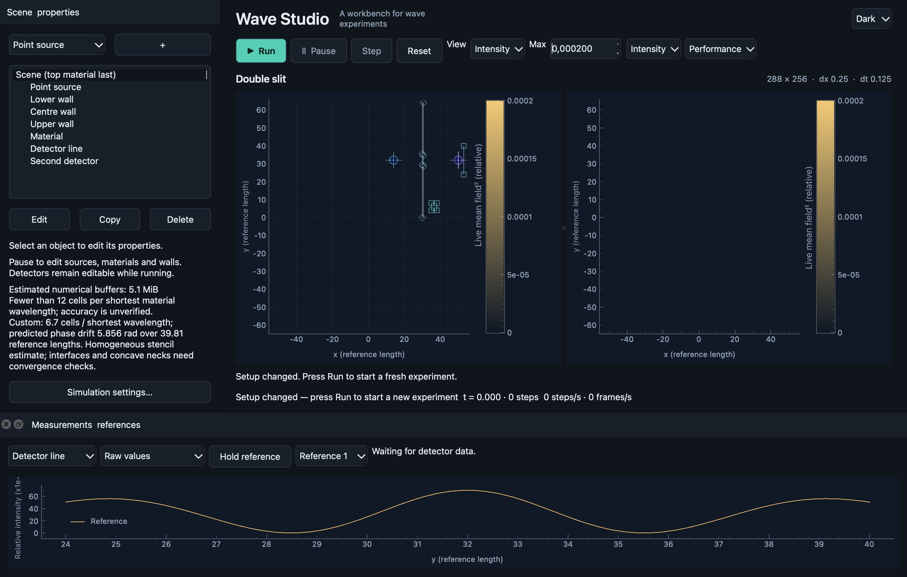

# Wave Studio

**An interactive desktop workbench for scalar 2D wave experiments.** Build a scene, watch waves propagate, measure interference and refraction, and compare detector profiles without writing a simulation script.

Wave Studio provides the editor, simulation controls, visualization and project files. Its numerical solver is developed separately in [WaveSimulator2D](https://github.com/flsmn/WaveSimulator2D), using PyTorch. The desktop interface uses PySide6 and PyQtGraph and is available in English.



*Development screenshot; the current interface includes additional probe and display controls.*

## Project status

The current source version is **0.1.0.dev16**, paired with **WaveSimulator2D 0.1.0.dev5**. This is an experimental application under active development, with local validation on an Apple M1 Mac with 8 GiB of memory. Windows and Linux packaging and acceptance are pending.

The repository contains source code, examples, tests and retained validation reports. Local application bundles under `dist/` are ignored by Git and are not included when cloning. A generally supported, signed and notarized desktop release has not been established. Numerical quality presets are resolution suggestions, not accuracy certificates for arbitrary experiments.

## Features

- **Scene editor:** point and finite line sources, rectangular and polygonal materials, opaque walls and biconvex lenses. Edit exact parameters, drag objects and handles, draw polygons, duplicate objects, and use Undo/Redo.
- **Simulation controls:** Run, Pause, single Step and Reset; selectable compute device; Economical and Performance modes; configurable grid, time step, damped boundary and resource limits.
- **Visualization:** signed field, material map and live intensity preview; independent display ranges; an optional synchronized second view; distance and angle measurements; light/dark themes and adjustable text size.
- **Passive detectors:** point and line probes with configurable settling times and finite measurement windows. Switch between mean field-square intensity and instantaneous signed field samples.
- **Reference comparisons:** retain up to four completed measurements with their scene and run metadata, and compare profiles on a shared raw or normalized scale.
- **Project files and exports:** validated, versioned `.wave.json` files, periodic recovery, PNG snapshots with metadata, and CSV profiles with raw values and measurement provenance.
- **Editable examples:** double slit, refraction and a biconvex lens, available from the File menu and in [`examples/`](examples/).

## Install and run from source

### Requirements

- **Python 3.12** (`>=3.12,<3.13`) and Git.
- A desktop environment capable of running Qt.
- The matching WaveSimulator2D source checkout. The application currently pins engine version `0.1.0.dev5`.

Runtime dependencies include PyTorch and NumPy through the engine, plus PySide6 and PyQtGraph. CPU execution is available; Apple MPS is exercised on the local Mac. Backend availability depends on the installed PyTorch build and hardware. Other platform/backend combinations require their own verification.

### macOS / Linux

Clone the repositories next to each other and install them into one virtual environment:

```sh
mkdir WaveStudioApp
cd WaveStudioApp
git clone https://github.com/flsmn/WaveSimulator2D.git
git clone https://github.com/flsmn/WaveStudio.git
cd WaveStudio
python3.12 -m venv .venv
source .venv/bin/activate
python -m pip install --upgrade pip
python -m pip install -e "../WaveSimulator2D[dev,validation]"
python -m pip install -e ".[dev]"
wave-studio
```

The engine's `validation` extra installs SciPy for independent numerical checks. It is optional for using the application and excluded from the desktop bundle. The `dev` extras install testing/build tools; omit both extras for a runtime-only source installation.

### Windows (source setup; not yet accepted)

After cloning the same two repositories into a common parent directory:

```powershell
cd WaveStudio
py -3.12 -m venv .venv
.venv\Scripts\Activate.ps1
python -m pip install --upgrade pip
python -m pip install -e "../WaveSimulator2D[dev,validation]"
python -m pip install -e ".[dev]"
wave-studio
```

Use a fresh environment with directly installed PyPI wheels for reproducible builds. Inheriting Conda site packages can cause PyInstaller dependency-hook problems. Once installed, `python -m wave_studio` is an alternative to `wave-studio`.

## First experiment

1. Open **File → Examples** and choose **Double slit**, or start a new experiment and add objects from the scene panel.
2. Select an object to edit its coordinates, source parameters or material properties. Later material objects override earlier materials; walls block the field.
3. Open **Simulation settings** to review the actual grid, compute device and estimated memory. Start with an affordable resolution.
4. Press **Run**. Switch between Field, Material and Intensity, or enable **View → Second view** to inspect two quantities at once.
5. Select a detector in **Measurements & references**. Allow its settling time and measurement window to finish, then use **Hold reference** before changing the experiment.
6. Export a completed profile/reference as CSV or save a PNG snapshot. Save the setup as a `.wave.json` project.

**Run after Pause** continues the existing run. Physical edits require Pause and invalidate the previous simulation; the next manual Run starts a fresh experiment. **Step** advances an initialized, paused run once. **Reset** releases the live simulation and measurements while preserving held references.

Detectors can be edited during a run: the changed detector starts a new measurement revision while the wave field continues. Project files preserve geometry, display settings, detectors and references; they do not contain a resumable wave field. See the [user guide](docs/USER_GUIDE.md) for the full workflow.

## Measurements and numerical limits

The model is **scalar, linear, two-dimensional and based on static materials**, with reference wave speed `c0 = 1`. Coordinates use a fixed project reference length. Source amplitude represents integrated forcing strength rather than optical power or prescribed displacement. The model does not describe polarization, material dispersion, absolute power or full 3D optics. The outer boundary is a damped zone, not a guaranteed reflection-free PML.

The main intensity view is a live exponential preview of relative field squared. Detector intensity uses a finite-window mean; completing a window does not establish that the field has reached steady state. Signed probe field samples remain live after the intensity window completes. Display normalization does not change stored measurements. [Probe display and export semantics](docs/PROBE_DISPLAY.md) describe the two quantities and reference behavior.

Preview, Balanced and High Quality presets account for wavelength, selected geometric features and estimated homogeneous phase drift. Interfaces, concave geometry, boundary reflections and finite measurement windows still require convergence and sensitivity checks. Historical demonstration tests retain their original tolerances. Independent source and volume-reference studies have both passing subcases and unresolved failures; full quantitative qualification of the presets, double slit and lens remains open. See the engine's [quantitative progress report](https://github.com/flsmn/WaveSimulator2D/blob/main/docs/QUANTITATIVE_PROGRESS.md).

### Resource behavior

The default admission limits are **512 MiB of estimated numerical buffers** and **4096 cells per axis**. Limits are configurable and saved per project; runtime, rendering and backend allocator overhead are additional. Raising a budget does not establish that a grid will fit or run interactively. Oversized scenes are rejected before raster allocation.

Large live field/intensity images are resampled to at most 1024 cells per axis for display; Pause and Step restore full-resolution frames. Solver updates and detector integration retain the full numerical grid. Economical mode caps numerical steps at 240/s, while display delivery is capped at 30 snapshots/s. Actual rates depend on the scene and hardware; solver steps and display frames measure different work. See [resource acceptance](docs/BALANCED_MAC_ACCEPTANCE.md) and [performance findings](docs/PERFORMANCE_INVESTIGATION.md).

## Development and validation

With the virtual environment activated, run the application and engine regression suites:

```sh
python -m pytest tests ../WaveSimulator2D/tests -q
```

Run the real Qt workflow check to exercise editing, simulation and exported artifacts:

```sh
python -m wave_studio --check-workflow /tmp/wave-studio-check
```

This opens a window, runs the check, writes artifacts and closes. For headless checks, set `QT_QPA_PLATFORM=offscreen`; those checks do not replace native desktop or accessibility testing.

The engine's physical reference runner is separate:

```sh
python ../WaveSimulator2D/validation/run_references.py --output /tmp/wave-physical-results.json
```

Hardware-specific checks live in [`scripts/`](scripts/), including backend, resource, quality and macOS bundle audits. Read their corresponding plans before interpreting results. Numerical reference checks can take substantially longer than regression tests, and some independent qualification runners intentionally return a failure status for unresolved criteria.

### Repository layout

```text
WaveStudio/
├── src/wave_studio/
│   ├── domain/          # Project model, quality estimates, history, resources
│   ├── simulation/      # Engine compilation, worker and lifecycle
│   ├── persistence/     # Validated project files and exports
│   ├── ui/              # Qt editor, dialogs and visualization
│   └── data/examples/   # Examples included in the installed package
├── examples/            # Editable project files
├── tests/               # Application regression tests
├── scripts/             # Hardware and acceptance diagnostics
├── packaging/           # Native bundle builder and PyInstaller spec
└── docs/                # Guides, contracts, plans and recorded results
```

Numerical solver changes belong in WaveSimulator2D. Editor, orchestration, persistence and display changes belong here. The repositories have independent Git histories and package versions.

## Build a native application

Build on the target operating system, using the matching engine and application wheels:

```sh
python -m build --wheel --no-isolation ../WaveSimulator2D
python -m build --wheel --no-isolation .
python packaging/build_native.py --engine-wheel ../WaveSimulator2D/dist/wave_simulator_2d-0.1.0.dev5-py3-none-any.whl --studio-wheel dist/wave_studio-0.1.0.dev16-py3-none-any.whl --distpath dist/ax-dev16
```

PyInstaller bundles Python and the numerical runtime from the supplied wheels. The resulting application does not require the source repositories or a user-installed Python. On the current Mac the candidate path is `dist/ax-dev16/WaveStudio.app`; `dist/WaveStudio.app` is an older historical build. These are local artifacts, not downloads supplied by this repository.

Current macOS bundles are arm64 and ad-hoc signed for local development. A supported minimum OS, clean-machine acceptance, public signing/notarization and distribution updates remain open. Windows and Linux native builds are pending. See [development and builds](docs/DEVELOPMENT.md) and [macOS distribution status](docs/MAC_DISTRIBUTION.md) before distributing a bundle.

## Documentation and contributing

| Topic | Reference |
| --- | --- |
| Using the editor and interpreting the model | [User guide](docs/USER_GUIDE.md) |
| Probe quantities, references and CSV | [Probe display](docs/PROBE_DISPLAY.md) |
| Setup, packaging and implementation details | [Development guide](docs/DEVELOPMENT.md) |
| Engine/application lifecycle and data contract | [Contract](docs/CONTRACT.md) |
| Acceptance evidence and remaining work | [Acceptance](docs/ACCEPTANCE.md), [task tracker](task.md) |
| Mac accessibility findings | [Accessibility follow-up](docs/MAC_ACCESSIBILITY_FOLLOWUP.md) |
| Product requirements and roadmap | [PRD](PRD.md), [project plan](PROJECT_PLAN.md), [development plan](DEVELOPMENT_PLAN.md) |

Some planning documents and historical reports are in German. Reports record the specific build, hardware and scope tested; they should not be read as blanket support or accuracy claims.

For bug reports, include the application and engine versions, OS, hardware, backend, grid settings, reproduction steps and a minimal `.wave.json` project where possible. For numerical issues, include measurement windows and convergence observations. Run relevant regression tests before proposing a change and keep engine changes in its separate repository.

## License

No project license has been selected or included in this repository. Dependency licenses apply separately; see the recorded [distribution status](docs/MAC_DISTRIBUTION.md) for the outstanding license and attribution work.
